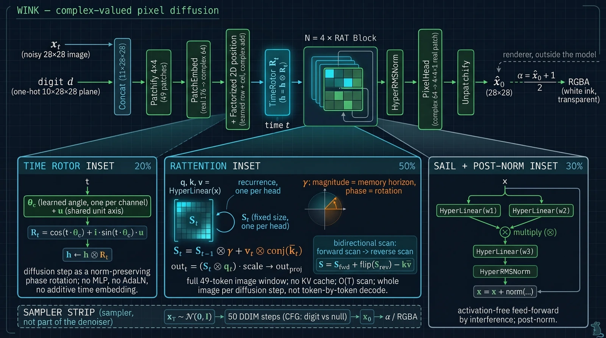

<div align="center">

# WINK<br><sup><small>*čili: difúze bez tréninkových koleček latentního prostoru*</small></sup>

🇬🇧 [English](README.md) | 🇩🇪 [Deutsch](README.de.md) | 🇨🇿 **Čeština** | 🇨🇳 [中文](README.zh.md) | 🇷🇺 [Русский](README.ru.md)

<a href="https://git.pvlb.dev/ml-lab/wink"> Hlavní repo — https://git.pvlb.dev/ml-lab/wink</a><br>
<small>GitHub mirror: <a href="https://github.com/pvlb-dev/wink" target="_blank">https://github.com/pvlb-dev/wink</a></small>

> Toto je český překlad pro v0.1.0. Závazná je anglická verze: [README.md](README.md).

---

</div>
<br>

### Vítejte v **WINK**, malé laboratoři pro generování obrazu s komplexními hodnotami!

**v0.1.0 (ve vývoji)** je **promptovatelný MNIST** difúzní model, který běží na CPU laptopu,
maluje bílým inkoustem na **průhledné pozadí** a generuje **zcela v prohlížeči**.
Vyberte číslici, nastavte guidance, dostanete číslici. 261k parametrů, 4 vrstvy,
RAT-32 — žádný VAE, žádný latentní dekodér, žádný server.

> **geneRATivní tvorba obrazu** — RAT z TARDITS, přesměrovaný z tokenů na pixely.

<p align="center">

</p>

Blok RAT a hyperkomplexní vrstvy pocházejí z
[TARDITS](https://git.pvlb.dev/ml-lab/tardits) (`tardits>=0.3.0`). Je to stejná
rodina RAT, ne stejný model: WINK přidává 2D patch tokeny, rotor difúzního kroku,
podmínění třídou a pixelovou hlavu. Zdejší 261k promptovatelný checkpoint
je model WINK, ne 100M základ TARDITS.

<br>

## 🚀 Rychlý start a použití

### Chcete si jen hrát?

10k promptovatelných vah už je v repozitáři. Trénink v Pythonu není potřeba:

```bash
python -m http.server 5001 -d web
# open http://127.0.0.1:5001
```

Tlačítka číslic + posuvník guidance, průhledný RGBA výstup, inference ve Web Workeru.
Viz [`web/README.md`](web/README.md).

### Instalace

```bash
git clone https://git.pvlb.dev/ml-lab/wink.git
cd wink
uv sync --locked --extra mlflow --extra eval
.venv/bin/pytest -q
```

### Trénink modelu 0.1 (CPU)

Trénink vydávaného 10k modelu trvá na t14 ~46 min. Pro rychlý první běh stačí 3k
promptovatelný model, který trvá ~15 min a používá stejný recept:

```bash
.venv/bin/wtrain -c examples/configs/mnist_rat_cond_cfg_h32.yaml
```

### Generování číslic podle zadání

```bash
.venv/bin/wsample \
  -c examples/configs/mnist_rat_cond_cfg_h32.yaml \
  --checkpoint examples/saved/mnist_rat_cond_cfg_h32/final.pt \
  -n 80 --classes 0,1,2,3,4,5,6,7,8,9 \
  --guidance 5 --alpha --nrow 8 -o prompted.png
```

Zapíše průhledný RGBA arch a náhled na šachovnici. Pro 10k model použijte
`examples/configs/mnist_rat_cond_cfg_h32_10k.yaml` a jeho `final.pt`.

### Bezpodmíněné alfa číslice

MNIST je bílý inkoust na černé, takže odstín šedi **je** alfa maska. Původní
RAT-16 checkpoint už je alfa model:

```bash
.venv/bin/wsample -c examples/configs/mnist_rat.yaml \
  --checkpoint examples/saved/mnist_rat_h16/final.pt \
  -n 64 --alpha -o alpha.png
```

Exportujte skutečný testovací split MNIST jako RGBA PNG (bez GIMPu):

```bash
.venv/bin/python docs/scripts/mnist_to_alpha.py --split test
```

### Sledování běhů

```bash
mlflow ui --backend-store-uri sqlite:///mlflow.db
```

<br>

## 🙃 Architektura

<details>
<summary><b>Kliknutím rozbalíte 🔻</b></summary>

<br>

<p align="center">

</p>

*Denoiser WINK. Rovina číslice se připojuje k zašuměnému obrazu; časový rotor se aplikuje po 2D pozici; renderer mimo model převádí x0 na RGBA.*

```text
x0 [B,C,H,W] -> 4x4 patches -> complex patch embedding
             -> + factorised 2D position (+ class plane in v0.1)
             -> time rotor R_t (ported from dagoBERT)
             -> hyper (full complex softmax) | rat (bidirectional fast-weight)
             -> complex head -> x0_hat [B,C,H,W]
```

- **Žádný VAE, žádný latent.** Difúze běží přímo v pixelovém prostoru na 28×28
  (MNIST) a 32×32 (CIFAR); za špatný vzorek může denoiser.
- **Patche:** 4×4, takže MNIST má 49 tokenů a CIFAR 64.
- **Čas:** naučený komplexní rotor otáčí latent podle difúzního kroku;
  žádná samostatná tabulka absolutního času.
- **RAT:** obousměrný blok fast-weight z `tardits`, se skenem po chuncích pro
  okno CIFAR o 64 tokenech. `hyper` je kontrola s plným softmaxem.
- **Podmínění (v0.1):** 10kanálová one-hot rovina číslice se v každém kroku DDIM
  připojuje k zašuměnému obrazu; 10% dropout třídy dává nulovou větev a
  classifier-free guidance (`--guidance`) donutí číslici poslechnout zadání.
  Jde o podmínění třídou číslice, ne volný text: UI mapuje „sedmičku“ na 7.
- **Úrovně:** `level` je pole konfigurace (ℂ, ℍ, 𝕆, …). Úroveň 1 je výchozí
  pro CPU; úrovně 2/3 na CIFAR fungují, ale v tomto měřítku stojí víc, než přinesou.

Podrobný návrh, invarianty a mapa portů:
[`docs/model-internals.md`](docs/model-internals.md).

</details>

## 🔥 Důkazy a měření

<details>
<summary><b>Kliknutím rozbalíte 🔻</b></summary>

<br>

### M1 — MNIST, 3k kroků na CPU

| model | val x0-MSE | poznámka |
|---|---:|---|
| hyper softmax | 0.0801 | vzorky jako kaňky |
| RAT-16 | **0.0629** | čitelné číslice |
| RAT-32 | 0.0617 | volba pro CPU, 217.5 ms/krok |

Kvalita se nasycuje kolem 8–32 hlav; rychlost se dál zlepšuje. Plné tabulky:
[`mnist-hyper-vs-rat.md`](docs/findings/mnist-hyper-vs-rat.md),
[`rat-head-sweep.md`](docs/experiments/2026-11-19-rat-head-sweep.md).

### M2 — CIFAR-10, 10k kroků, FID vůči 10k skutečných obrázků

| model | val x0-MSE | FID |
|---|---:|---:|
| hyper 10k | 0.0347 | 160.36 |
| RAT-32 10k | 0.0351 | **156.12** |
| RAT-32 20k kosinus | 0.0326 @17k | 178.68 |
| RAT-32 šířka 96, 10k | **0.0330** | **149.60** |
| kvaternionová úroveň 2, 10k | 0.0342 | 170.04 |

Poctivý příběh: RAT vyhrává při 49 tokenech; CIFAR je na úrovni textur, ne
objektů; více kroků může snížit val, a přitom zhoršit FID; šířka pomáhá, hloubka
a vyšší úrovně nejsou zadarmo. Reporty:
[`2026-11-19-cifar10-10k.md`](docs/experiments/2026-11-19-cifar10-10k.md),
[`2026-11-20-cifar10-rat-chunked.md`](docs/experiments/2026-11-20-cifar10-rat-chunked.md),
[`2026-11-20-cifar10-head-sweep.md`](docs/experiments/2026-11-20-cifar10-head-sweep.md),
[`2026-11-20-cifar10-20k-cosine.md`](docs/experiments/2026-11-20-cifar10-20k-cosine.md),
[`2026-11-21-cifar10-levels.md`](docs/experiments/2026-11-21-cifar10-levels.md),
[`2026-11-21-cifar10-param-matched-10k.md`](docs/experiments/2026-11-21-cifar10-param-matched-10k.md).

### 0.1 — promptovatelný MNIST

| model | parametry | rozpočet | val x0-MSE |
|---|---:|---:|---:|
| bez podmínění, RAT-32 | 250k | 3k | 0.0617 |
| kanál + dropout třídy + CFG | 261k | 10k | **0.0435** |

Mřížka číslic 0–9 podle zadání:
[`prompted_digits_10k_preview.png`](docs/assets/mnist/prompted_digits_10k_preview.png).
Podrobnosti: [`2026-11-21-mnist-promptable.md`](docs/experiments/2026-11-21-mnist-promptable.md).

### Co (zatím) nefungovalo

- 1 000 kroků / epsilon predikce při 0.24M parametrech: x0 při silném šumu byl
  příliš nepřesný; sampler zůstal šum.
- v-predikce při 1 000 krocích: uvízla na plató.
- Aditivní sinusové časové podmínění: pomalejší konvergence.
- Delší trénink CIFAR (20k) a kvaternionová úroveň 2 při stejném počtu parametrů:
  nižší val, horší FID.
- Kontrola s 6 vrstvami byla odložena při ~1.5 s/krok pod zátěží laptopu.

Jsou zaznamenány jako nulové výsledky, nikoli skryty.

</details>

## 🗺️ Mapa repozitáře a dokumentace

<details>
<summary><b>Kliknutím rozbalíte 🔻</b></summary>

<br>

```text
src/wink/            models, diffusion, trainer, data, alpha, CLIs
examples/configs/    MNIST, promptable, CIFAR and level experiments
docs/                findings, experiments, model internals, repo map
web/                 pure-JS promptable toy + exported weights
tests/               38 tests (no network needed)
AGENTS.d/            private knowledge clone, not tracked here
```

- [`docs/index.md`](docs/index.md) — index zjištění a experimentů.
- [`docs/repo-map.md`](docs/repo-map.md) — kde co leží.
- [`docs/findings/alpha-mnist.md`](docs/findings/alpha-mnist.md) — průhledné
  číslice bez přetrénování.
- [`web/README.md`](web/README.md) — inference v prohlížeči a poznámky
  k integraci webového frontendu.
- CI jsou Forgejo Actions (`runs-on: docker`), jen ruční spuštění + `master`.

</details>

## 🧭 Výhled

- **0.1.0:** zabalit CPU MNIST vydání (rychlý start, changelog, tag).
- **Fashion-MNIST:** druhá drobná datová sada, stejná alfa/promptovatelná pipeline.
- **RGBA:** difúze skutečných barev + alfy, ne jen šedá jako alfa.
- **Kapacita CIFAR:** šířka 128 a férový plán pro úroveň 2; běh se šířkou 96 má
  zatím nejlepší FID.
- **Podmínění textem** a varianty s VAE/latentem jsou mimo rozsah v0.

<br>

## 📜 Licence a uvedení zdrojů

Apache-2.0; viz [`LICENSE`](LICENSE). WINK je obrazový sourozenec
[TARDITS](https://git.pvlb.dev/ml-lab/tardits); blok RAT a hyperkomplexní
vrstvy jsou společné, obrazový model je vlastní.
