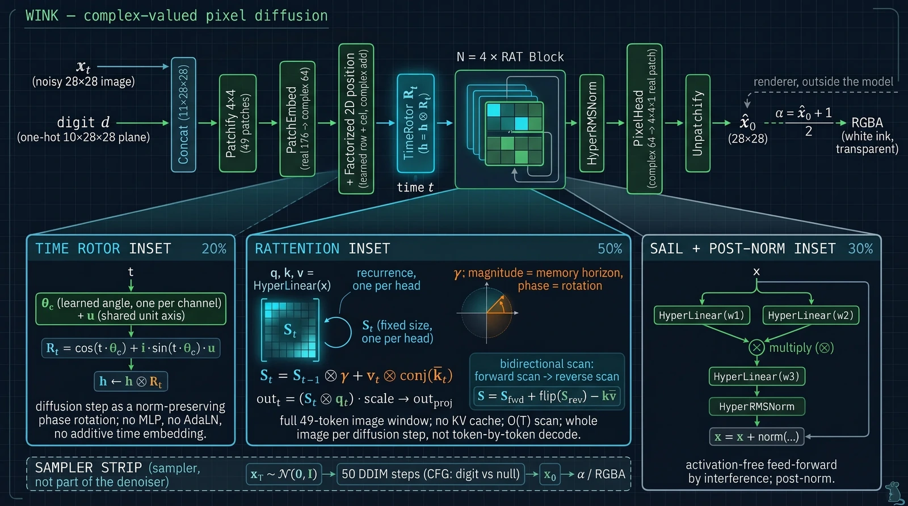

<div align="center">

# WINK<br><sup><small>*oder: Diffusion ohne die Stützräder des Latent-Raums*</small></sup>

🇬🇧 [English](README.md) | 🇩🇪 **Deutsch** | 🇨🇿 [Čeština](README.cs.md) | 🇨🇳 [中文](README.zh.md) | 🇷🇺 [Русский](README.ru.md)

<a href="https://git.pvlb.dev/ml-lab/wink"> Haupt-Repo — https://git.pvlb.dev/ml-lab/wink</a><br>
<small>GitHub mirror: <a href="https://github.com/pvlb-dev/wink" target="_blank">https://github.com/pvlb-dev/wink</a></small>

> Dies ist die deutsche Übersetzung für v0.1.0. Das englische README ist die maßgebliche Fassung: [README.md](README.md).

---

</div>
<br>

### Willkommen bei **WINK**, einem winzigen Labor für komplexwertige Bilderzeugung!

**v0.1.0 (in Arbeit)** ist ein **promptbares MNIST**-Diffusionsmodell, das auf einer Laptop-CPU läuft,
weiße Tinte auf einen **transparenten Hintergrund** malt und **vollständig im
Browser** generiert. Ziffer wählen, Guidance einstellen, Ziffer bekommen. 261k Parameter, 4 Layer,
RAT-32 — kein VAE, kein Latent-Decoder, kein Server.

> **image geneRATion** — der RAT aus TARDITS, von Tokens auf Pixel umgerichtet.

<p align="center">

</p>

Der RAT-Block und die hyperkomplexen Layer stammen aus
[TARDITS](https://git.pvlb.dev/ml-lab/tardits) (`tardits>=0.3.0`). Es ist dieselbe
RAT-Familie, nicht dasselbe Modell: WINK ergänzt 2D-Patch-Tokens, einen
Diffusionsschritt-Rotor, Klassenkonditionierung und einen Pixel-Head. Der promptbare
Checkpoint mit 261k hier ist ein WINK-Modell, nicht die 100M-Basis von TARDITS.

<br>

## 🚀 Schnellstart & Nutzung

### Einfach nur spielen?

Die 10k promptbaren Gewichte liegen bereits im Repo. Kein Python-Training nötig:

```bash
python -m http.server 5001 -d web
# open http://127.0.0.1:5001
```

Ziffern-Buttons + Guidance-Slider, transparente RGBA-Ausgabe, Inferenz im Web Worker.
Siehe [`web/README.md`](web/README.md).

### Installation

```bash
git clone https://git.pvlb.dev/ml-lab/wink.git
cd wink
uv sync --locked --extra mlflow --extra eval
.venv/bin/pytest -q
```

### Das 0.1-Modell trainieren (CPU)

Das 10k-Release-Modell braucht auf t14 ~46 min. Für einen schnellen ersten Lauf
braucht das 3k-promptbare Modell ~15 min und nutzt dasselbe Rezept:

```bash
.venv/bin/wtrain -c examples/configs/mnist_rat_cond_cfg_h32.yaml
```

### Gepromptete Ziffern erzeugen

```bash
.venv/bin/wsample \
  -c examples/configs/mnist_rat_cond_cfg_h32.yaml \
  --checkpoint examples/saved/mnist_rat_cond_cfg_h32/final.pt \
  -n 80 --classes 0,1,2,3,4,5,6,7,8,9 \
  --guidance 5 --alpha --nrow 8 -o prompted.png
```

Schreibt ein transparentes RGBA-Blatt und eine Schachbrett-Vorschau. Für das 10k-Modell
`examples/configs/mnist_rat_cond_cfg_h32_10k.yaml` und dessen `final.pt` verwenden.

### Alpha-Ziffern ohne Konditionierung

MNIST ist weiße Tinte auf Schwarz, die Graustufen-Intensität **ist** also eine Alpha-Maske. Der
ursprüngliche RAT-16-Checkpoint ist bereits ein Alpha-Modell:

```bash
.venv/bin/wsample -c examples/configs/mnist_rat.yaml \
  --checkpoint examples/saved/mnist_rat_h16/final.pt \
  -n 64 --alpha -o alpha.png
```

Den echten MNIST-Test-Split als RGBA-PNGs exportieren (ohne GIMP):

```bash
.venv/bin/python docs/scripts/mnist_to_alpha.py --split test
```

### Läufe verfolgen

```bash
mlflow ui --backend-store-uri sqlite:///mlflow.db
```

<br>

## 🙃 Architektur

<details>
<summary><b>Zum Aufklappen klicken 🔻</b></summary>

<br>

<p align="center">

</p>

*Der WINK-Denoiser. Die Ziffern-Ebene wird an das verrauschte Bild konkateniert; der Zeit-Rotor wird nach der 2D-Position angewendet; der Renderer außerhalb des Modells macht aus x0 RGBA.*

```text
x0 [B,C,H,W] -> 4x4 patches -> complex patch embedding
             -> + factorised 2D position (+ class plane in v0.1)
             -> time rotor R_t (ported from dagoBERT)
             -> hyper (full complex softmax) | rat (bidirectional fast-weight)
             -> complex head -> x0_hat [B,C,H,W]
```

- **Kein VAE, kein Latent.** Die Diffusion läuft direkt im Pixelraum bei 28×28
  (MNIST) und 32×32 (CIFAR); ein schlechtes Sample ist der Fehler des Denoisers.
- **Patches:** 4×4, damit hat MNIST 49 Tokens und CIFAR 64.
- **Zeit:** Ein gelernter komplexer Rotor rotiert das Latent abhängig vom Diffusionsschritt;
  keine separate absolute Zeit-Tabelle.
- **RAT:** der bidirektionale Fast-Weight-Block aus `tardits`, mit einem gechunkten
  Scan für das 64-Token-Fenster von CIFAR. `hyper` ist die Full-Softmax-Kontrolle.
- **Konditionierung (v0.1):** Bei jedem DDIM-Schritt wird eine 10-kanalige One-Hot-Ziffernebene
  an das verrauschte Bild konkateniert; 10 % Class-Dropout liefert einen Null-Zweig, und
  Classifier-Free-Guidance (`--guidance`) sorgt dafür, dass die Ziffer dem Prompt folgt.
  Das ist Ziffernklassen-Konditionierung, kein Freitext: Die UI übersetzt „seven“ in 7.
- **Levels:** `level` ist ein Konfigurationsfeld (ℂ, ℍ, 𝕆, …). Level 1 ist der
  CPU-Standard; Level 2/3 funktionieren auf CIFAR, kosten in dieser Größenordnung aber
  mehr, als sie einbringen.

Das detaillierte Design, die Invarianten und die Port-Map:
[`docs/model-internals.md`](docs/model-internals.md).

</details>

## 🔥 Belege & Messungen

<details>
<summary><b>Zum Aufklappen klicken 🔻</b></summary>

<br>

### M1 — MNIST, 3k CPU-Schritte

| Modell | val x0-MSE | Anmerkung |
|---|---:|---|
| hyper softmax | 0.0801 | klumpige Samples |
| RAT-16 | **0.0629** | lesbare Ziffern |
| RAT-32 | 0.0617 | CPU-Wahl, 217.5 ms/Schritt |

Die Qualität sättigt bei etwa 8–32 Heads; die Geschwindigkeit steigt weiter. Vollständige Tabellen:
[`mnist-hyper-vs-rat.md`](docs/findings/mnist-hyper-vs-rat.md),
[`rat-head-sweep.md`](docs/experiments/2026-11-19-rat-head-sweep.md).

### M2 — CIFAR-10, 10k Schritte, FID gegen 10k echte Bilder

| Modell | val x0-MSE | FID |
|---|---:|---:|
| hyper 10k | 0.0347 | 160.36 |
| RAT-32 10k | 0.0351 | **156.12** |
| RAT-32 20k cosine | 0.0326 @17k | 178.68 |
| RAT-32 Breite 96, 10k | **0.0330** | **149.60** |
| Quaternion Level 2, 10k | 0.0342 | 170.04 |

Die ehrliche Geschichte: RAT gewinnt bei 49 Tokens; CIFAR bleibt auf Textur-Ebene, nicht auf Objektebene;
mehr Schritte können val senken und dabei FID verschlechtern; Breite hilft, Tiefe und höhere Level
sind keine Gratis-Siege. Berichte:
[`2026-11-19-cifar10-10k.md`](docs/experiments/2026-11-19-cifar10-10k.md),
[`2026-11-20-cifar10-rat-chunked.md`](docs/experiments/2026-11-20-cifar10-rat-chunked.md),
[`2026-11-20-cifar10-head-sweep.md`](docs/experiments/2026-11-20-cifar10-head-sweep.md),
[`2026-11-20-cifar10-20k-cosine.md`](docs/experiments/2026-11-20-cifar10-20k-cosine.md),
[`2026-11-21-cifar10-levels.md`](docs/experiments/2026-11-21-cifar10-levels.md),
[`2026-11-21-cifar10-param-matched-10k.md`](docs/experiments/2026-11-21-cifar10-param-matched-10k.md).

### 0.1 — promptbares MNIST

| Modell | Parameter | Budget | val x0-MSE |
|---|---:|---:|---:|
| RAT-32 ohne Konditionierung | 250k | 3k | 0.0617 |
| Kanal + Class-Dropout + CFG | 261k | 10k | **0.0435** |

Gepromptetes Raster 0–9:
[`prompted_digits_10k_preview.png`](docs/assets/mnist/prompted_digits_10k_preview.png).
Details: [`2026-11-21-mnist-promptable.md`](docs/experiments/2026-11-21-mnist-promptable.md).

### Was (noch) nicht funktioniert hat

- 1,000-Schritte-/Epsilon-Vorhersage bei 0.24M Parametern: x0 war bei hohem Rauschen
  zu ungenau; der Sampler blieb Rauschen.
- v-Vorhersage bei 1,000 Schritten: Plateau.
- Additive sinusförmige Zeit-Konditionierung: langsamere Konvergenz.
- Längeres CIFAR-Training (20k) und Quaternion Level 2 bei gleichen Parametern: niedrigere val,
  schlechtere FID.
- Eine Tiefen-Kontrolle mit 6 Layern wurde bei ~1.5 s/Schritt unter Laptop-Last zurückgestellt.

Diese sind als Nullergebnisse festgehalten, nicht versteckt.

</details>

## 🗺️ Repo-Karte & Docs

<details>
<summary><b>Zum Aufklappen klicken 🔻</b></summary>

<br>

```text
src/wink/            models, diffusion, trainer, data, alpha, CLIs
examples/configs/    MNIST, promptable, CIFAR and level experiments
docs/                findings, experiments, model internals, repo map
web/                 pure-JS promptable toy + exported weights
tests/               38 tests (no network needed)
AGENTS.d/            private knowledge clone, not tracked here
```

- [`docs/index.md`](docs/index.md) — Index der Findings und Experimente.
- [`docs/repo-map.md`](docs/repo-map.md) — wo alles liegt.
- [`docs/findings/alpha-mnist.md`](docs/findings/alpha-mnist.md) — transparente
  Ziffern ohne Neutraining.
- [`web/README.md`](web/README.md) — Notizen zu Browser-Inferenz und
  Web-Frontend-Integration.
- CI ist Forgejo Actions (`runs-on: docker`), nur manueller Dispatch + `master`.

</details>

## 🧭 Ausblick

- **0.1.0:** das CPU-MNIST-Release paketieren (Schnellstart, Changelog, Tag).
- **Fashion-MNIST:** zweiter winziger Datensatz, dieselbe Alpha-/Promptable-Pipeline.
- **RGBA:** echte Farbe + Alpha-Diffusion, nicht nur Graustufen-als-Alpha.
- **CIFAR-Kapazität:** Breite 128 und ein fairer Level-2-Zeitplan; der 96-breite Lauf ist
  die aktuell beste FID.
- **Textkonditionierung** und VAE-/Latent-Varianten sind für v0 außerhalb des Umfangs.

<br>

## 📜 Lizenz & Attribution

Apache-2.0; siehe [`LICENSE`](LICENSE). WINK ist das Bild-Geschwister von
[TARDITS](https://git.pvlb.dev/ml-lab/tardits); der RAT-Block und die hyperkomplexen
Layer sind geteilt, das Bildmodell ist sein eigenes.
