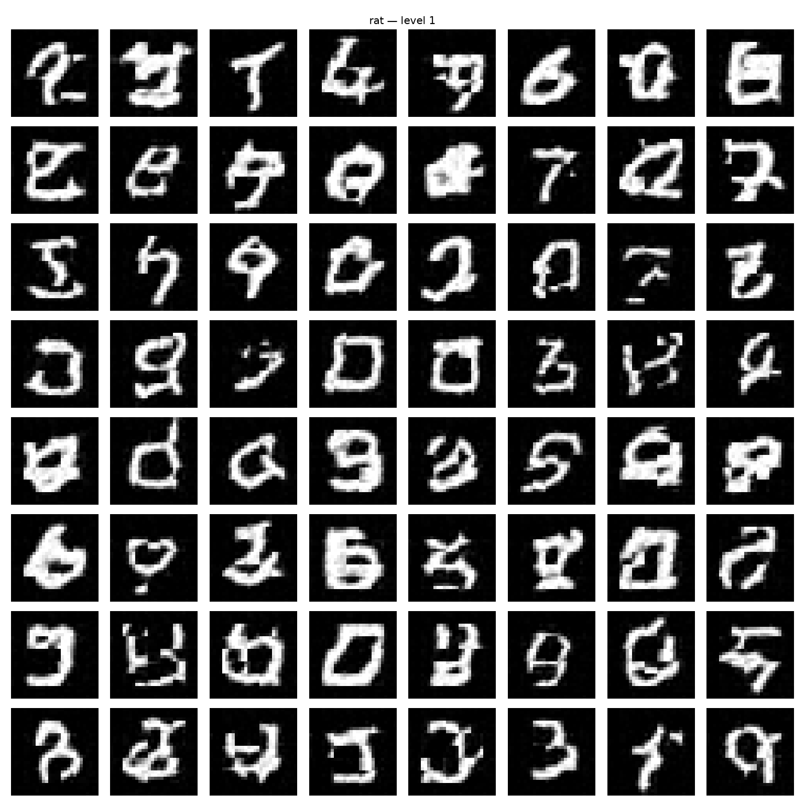

# WINK

**Complex-valued pixel diffusion — the visual counterpart to [TARDITS](https://git.pvlb.dev/ml-lab/tardits).**

WINK is a small lab for image generation with the same activation-free,
complex-valued transformer stack as TARDITS. The first model is a pixel-space
diffusion transformer on MNIST: 28×28 images are cut into 4×4 patches, embedded
into a complex latent, rotated by a diffusion-step rotor, and denoised by either
a full complex softmax transformer (`hyper`) or the RAT fast-weight memory
(`rat`). There is **no autoencoder**; at this resolution diffusion runs directly
in pixel space, so a bad sample is the denoiser's fault and not a decoder's.

The research question for the first milestone was deliberately narrow:

> Does a complex-valued diffusion transformer learn images at all, and which
> attention — hyper or RAT — is the better prior for short image sequences?

**First answer (M1, 3,000 CPU steps, 49 tokens): RAT with many heads wins.**
The prior was hyper, based on dagoBERT's T=80 A/B. At 49 tokens and
`n_head=16`, the bidirectional RAT denoiser reached val x0-MSE **0.0629** and
produced readable digits; the matched hyper softmax baseline reached **0.0801**
and its samples stayed blob-like. RAT-16 is also **2.6× faster per step** than
RAT-4 on CPU (398 ms vs 1,033 ms), so the operator's "RAT loves many heads" note
held. The full table, the failed runs and the caveats are in
[`docs/findings/mnist-hyper-vs-rat.md`](docs/findings/mnist-hyper-vs-rat.md).



## Status

- **M1 (done):** MNIST, both denoisers, matched CPU budget, sample grids, decision
  note. The best recipe is `mnist_rat.yaml` (RAT, 16 heads, 200 diffusion steps,
  x0 prediction, EMA 0.999).
- **M2 (next):** CIFAR-10 class-conditional at 32×32, FID over ≥10,000 samples.
- Text conditioning, CelebA and any VAE/latent variant are out of scope for v0.

Training on Kaggle/Colab is currently blocked by the tesseract runs, so all
results here are CPU-only on t14. The package is not published yet.

## Quickstart

```bash
uv sync --locked --extra mlflow
.venv/bin/pytest -q

# the working recipe (CPU, ~19 min, 3,000 steps)
.venv/bin/wtrain -c examples/configs/mnist_rat.yaml

# the matched hyper baseline (~11 min)
.venv/bin/wtrain -c examples/configs/mnist_hyper.yaml

# sample a grid from a checkpoint
.venv/bin/wsample -c examples/configs/mnist_rat.yaml \
  --checkpoint examples/saved/mnist_rat_h16/final.pt \
  -n 64 --steps 50 -o samples.png

# inspect the runs
mlflow ui --backend-store-uri sqlite:///mlflow.db
```

## Architecture

```text
x0 [B,C,H,W] -> 4x4 patches -> complex patch embedding
             -> + factorised 2D position + class embedding
             -> time rotor R_t (ported from dagoBERT)
             -> hyper (full softmax) | rat (bidirectional fast-weight)
             -> complex head -> x0/eps_hat [B,C,H,W]
```

- **Diffusion:** linear beta schedule; the working MNIST recipe uses 200 steps,
  x0 prediction, DDIM 50 for reporting, and EMA 0.999. Longer 1,000-step
  schedules and epsilon/v targets are config options and are documented as
  underfit at this CPU budget.
- **Denoisers:** `hyper` uses `Re(QK†)` full attention with post-norm residual and
  SAIL; `rat` uses the bidirectional RAT block from `tardits`. `n_head=16` is the
  recommended RAT setting at `n_embd=64`.
- **Conditioning:** the diffusion-step rotor rotates every patch token; CIFAR adds
  a learned class embedding. No AdaLN or classifier-free guidance in v0.
- **Dimensions:** `level` (complex, quaternion, …), `n_embd`, `n_head` and
  `n_layer` are config fields. Level 1 is the CPU default; level 2 is smoke-tested.

The detailed design, invariants and port map are in
[`docs/model-internals.md`](docs/model-internals.md); the repo map is
[`docs/repo-map.md`](docs/repo-map.md).

## What did not work (yet)

- 1,000-step / epsilon prediction at 0.24M params: low-noise denoising was good,
  but the high-noise x0 estimate was too inaccurate and the sampler stayed noise.
- v-prediction at 1,000 steps: plateaued; no better than epsilon at this budget.
- Additive sinusoidal time conditioning next to the rotor: slower convergence.
- Wider 96×6 hyper: better than the small hyper, still behind RAT-16 at 3k steps.

These are recorded as nulls, not hidden. The next real lever is training budget or
an accelerator, not another silent architecture change.

## Repo conventions

- `src/wink/` mirrors `src/tardits/`: `models/` for architectures, `modules/` for
  algebra-adjacent building blocks, `train.py` / `sample.py` for the CLIs.
- `AGENTS.md` is the agent map. The detailed knowledge lives in `AGENTS.d/`, a
  separate private clone of `agentic/wink`, deliberately not part of this repo.
- Work state lives in Forgejo issues and milestones, not in files.
- MLflow runs are local (`sqlite:///mlflow.db`); the reports under `docs/` carry
  the params, budget, metrics and run IDs that matter.

## License

Apache-2.0. See [`LICENSE`](LICENSE).
