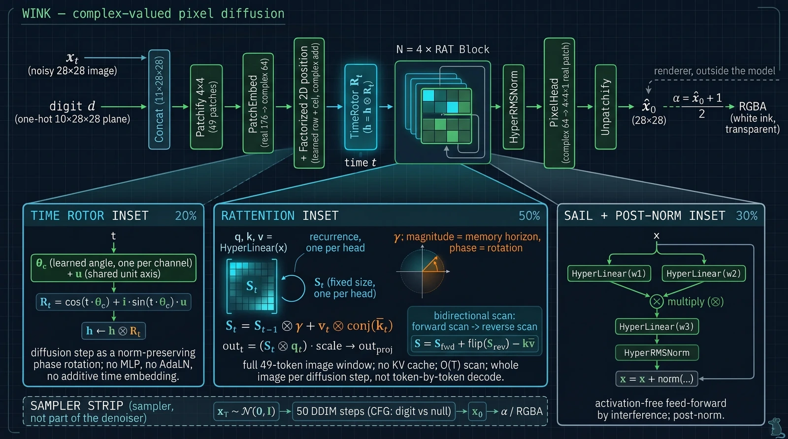

<div align="center">

# WINK<br><sup><small>*или: диффузия без латентных страховочных колёсиков*</small></sup>

🇬🇧 [English](README.md) | 🇩🇪 [Deutsch](README.de.md) | 🇨🇿 [Čeština](README.cs.md) | 🇨🇳 [中文](README.zh.md) | 🇷🇺 **Русский**

<a href="https://git.pvlb.dev/ml-lab/wink"> Домашний репозиторий — https://git.pvlb.dev/ml-lab/wink</a><br>
<small>Зеркало GitHub: <a href="https://github.com/pvlb-dev/wink" target="_blank">https://github.com/pvlb-dev/wink</a></small>

> Это русский перевод для v0.1.0. Авторитетной является английская версия: [README.md](README.md).

---

</div>
<br>

### Добро пожаловать в **WINK** — крошечную лабораторию комплекснозначной генерации изображений!

**v0.1.0 (в разработке)** — это диффузионная модель **MNIST с промптами**, которая
работает на CPU ноутбука, рисует белыми чернилами на **прозрачном фоне** и
генерирует **полностью в браузере**. Выберите цифру, задайте guidance — получите
цифру. 261k параметров, 4 слоя, RAT-32 — без VAE, без латентного декодера, без
сервера.

> **image geneRATion** — RAT из TARDITS, перенацеленный с токенов на пиксели.

<p align="center">

</p>

Блок RAT и гиперкомплексные слои взяты из
[TARDITS](https://git.pvlb.dev/ml-lab/tardits) (`tardits>=0.3.0`). Это то же
семейство RAT, но не та же модель: WINK добавляет 2D-патч-токены, ротор шага
диффузии, классовое кондиционирование и пиксельную голову. Чекпойнт с промптами
на 261k, лежащий здесь, — это модель WINK, а не база TARDITS на 100M.

<br>

## 🚀 Быстрый старт и использование

### Просто хотите поиграть?

10k-веса с промптами уже лежат в репозитории. Обучение на Python не требуется:

```bash
python -m http.server 5001 -d web
# open http://127.0.0.1:5001
```

Кнопки цифр + слайдер guidance, прозрачный вывод RGBA, инференс в Web Worker.
См. [`web/README.md`](web/README.md).

### Установка

```bash
git clone https://git.pvlb.dev/ml-lab/wink.git
cd wink
uv sync --locked --extra mlflow --extra eval
.venv/bin/pytest -q
```

### Обучение модели 0.1 (CPU)

Релизная 10k-модель обучается ~46 мин на t14. Для быстрого первого запуска
модель на 3k с промптами обучается ~15 мин и использует тот же рецепт:

```bash
.venv/bin/wtrain -c examples/configs/mnist_rat_cond_cfg_h32.yaml
```

### Генерация цифр по промпту

```bash
.venv/bin/wsample \
  -c examples/configs/mnist_rat_cond_cfg_h32.yaml \
  --checkpoint examples/saved/mnist_rat_cond_cfg_h32/final.pt \
  -n 80 --classes 0,1,2,3,4,5,6,7,8,9 \
  --guidance 5 --alpha --nrow 8 -o prompted.png
```

Записывает прозрачный лист RGBA и превью на шахматной подложке. Для модели 10k
используйте `examples/configs/mnist_rat_cond_cfg_h32_10k.yaml` и её `final.pt`.

### Безусловные alpha-цифры

MNIST — это белые чернила на чёрном, поэтому интенсивность в градациях серого
**и есть** alpha-маска. Исходный чекпойнт RAT-16 уже является alpha-моделью:

```bash
.venv/bin/wsample -c examples/configs/mnist_rat.yaml \
  --checkpoint examples/saved/mnist_rat_h16/final.pt \
  -n 64 --alpha -o alpha.png
```

Экспортируйте настоящий тестовый сплит MNIST в RGBA PNG (без GIMP):

```bash
.venv/bin/python docs/scripts/mnist_to_alpha.py --split test
```

### Отслеживание запусков

```bash
mlflow ui --backend-store-uri sqlite:///mlflow.db
```

<br>

## 🙃 Архитектура

<details>
<summary><b>Нажмите, чтобы развернуть 🔻</b></summary>

<br>

<p align="center">

</p>

*Денойзер WINK. Плоскость цифры конкатенируется с зашумлённым изображением;
временной ротор применяется после 2D-позиции; рендерер вне модели превращает x0
в RGBA.*

```text
x0 [B,C,H,W] -> 4x4 patches -> complex patch embedding
             -> + factorised 2D position (+ class plane in v0.1)
             -> time rotor R_t (ported from dagoBERT)
             -> hyper (full complex softmax) | rat (bidirectional fast-weight)
             -> complex head -> x0_hat [B,C,H,W]
```

- **Без VAE, без латента.** Диффузия идёт прямо в пиксельном пространстве 28×28
  (MNIST) и 32×32 (CIFAR); плохой сэмпл — вина денойзера.
- **Патчи:** 4×4, поэтому MNIST — это 49 токенов, а CIFAR — 64.
- **Время:** обучаемый комплексный ротор поворачивает латент на шаг диффузии;
  отдельной таблицы абсолютного времени нет.
- **RAT:** двунаправленный fast-weight блок из `tardits`, с чанковым сканом для
  окна CIFAR в 64 токена. `hyper` — контроль с полным softmax.
- **Кондиционирование (v0.1):** 10-канальная one-hot плоскость цифры
  конкатенируется с зашумлённым изображением на каждом шаге DDIM; 10% class
  dropout даёт null-ветку, а classifier-free guidance (`--guidance`) заставляет
  цифру слушаться промпта. Это кондиционирование по классу цифры, а не свободный
  текст: UI сопоставляет «семь» → 7.
- **Уровни:** `level` — это поле конфига (ℂ, ℍ, 𝕆, …). Уровень 1 — значение по
  умолчанию для CPU; уровни 2/3 работают на CIFAR, но при таком масштабе
  обходятся дороже, чем окупаются.

Подробный дизайн, инварианты и карта портирования:
[`docs/model-internals.md`](docs/model-internals.md).

</details>

## 🔥 Доказательства и измерения

<details>
<summary><b>Нажмите, чтобы развернуть 🔻</b></summary>

<br>

### M1 — MNIST, 3k шагов на CPU

| модель | val x0-MSE | примечание |
|---|---:|---|
| hyper softmax | 0.0801 | образцы в виде пятен |
| RAT-16 | **0.0629** | читаемые цифры |
| RAT-32 | 0.0617 | выбор для CPU, 217.5 мс/шаг |

Качество насыщается около 8–32 голов; скорость продолжает расти. Полные таблицы:
[`mnist-hyper-vs-rat.md`](docs/findings/mnist-hyper-vs-rat.md),
[`rat-head-sweep.md`](docs/experiments/2026-11-19-rat-head-sweep.md).

### M2 — CIFAR-10, 10k шагов, FID против 10k реальных изображений

| модель | val x0-MSE | FID |
|---|---:|---:|
| hyper 10k | 0.0347 | 160.36 |
| RAT-32 10k | 0.0351 | **156.12** |
| RAT-32 20k cosine | 0.0326 @17k | 178.68 |
| RAT-32 width 96, 10k | **0.0330** | **149.60** |
| quaternion level 2, 10k | 0.0342 | 170.04 |

Честная история: RAT выигрывает при 49 токенах; CIFAR — это уровень текстур, а не
объектов; больше шагов может снизить val, ухудшив FID; ширина помогает, а глубина
и более высокие уровни — не бесплатные улучшения. Отчёты:
[`2026-11-19-cifar10-10k.md`](docs/experiments/2026-11-19-cifar10-10k.md),
[`2026-11-20-cifar10-rat-chunked.md`](docs/experiments/2026-11-20-cifar10-rat-chunked.md),
[`2026-11-20-cifar10-head-sweep.md`](docs/experiments/2026-11-20-cifar10-head-sweep.md),
[`2026-11-20-cifar10-20k-cosine.md`](docs/experiments/2026-11-20-cifar10-20k-cosine.md),
[`2026-11-21-cifar10-levels.md`](docs/experiments/2026-11-21-cifar10-levels.md),
[`2026-11-21-cifar10-param-matched-10k.md`](docs/experiments/2026-11-21-cifar10-param-matched-10k.md).

### 0.1 — MNIST с промптами

| модель | параметры | бюджет | val x0-MSE |
|---|---:|---:|---:|
| unconditional RAT-32 | 250k | 3k | 0.0617 |
| channel + class dropout + CFG | 261k | 10k | **0.0435** |

Сетка промптов 0–9:
[`prompted_digits_10k_preview.png`](docs/assets/mnist/prompted_digits_10k_preview.png).
Детали: [`2026-11-21-mnist-promptable.md`](docs/experiments/2026-11-21-mnist-promptable.md).

### Что не сработало (пока)

- 1,000 шагов / epsilon-предсказание при 0.24M параметров: x0 при высоком шуме
  был слишком неточным; сэмплер оставался шумом.
- v-предсказание при 1,000 шагах: вышло на плато.
- Аддитивное синусоидальное кондиционирование по времени: более медленная
  сходимость.
- Более долгое обучение CIFAR (20k) и кватернионный уровень 2 при равных
  параметрах: ниже val, хуже FID.
- Контрольный прогон с глубиной 6 слоёв отложен при ~1.5 с/шаг под нагрузкой
  ноутбука.

Это записано как отрицательные результаты, а не скрыто.

</details>

## 🗺️ Карта репозитория и документация

<details>
<summary><b>Нажмите, чтобы развернуть 🔻</b></summary>

<br>

```text
src/wink/            models, diffusion, trainer, data, alpha, CLIs
examples/configs/    MNIST, promptable, CIFAR and level experiments
docs/                findings, experiments, model internals, repo map
web/                 pure-JS promptable toy + exported weights
tests/               38 tests (no network needed)
AGENTS.d/            private knowledge clone, not tracked here
```

- [`docs/index.md`](docs/index.md) — индекс находок и экспериментов.
- [`docs/repo-map.md`](docs/repo-map.md) — что где лежит.
- [`docs/findings/alpha-mnist.md`](docs/findings/alpha-mnist.md) — прозрачные
  цифры без переобучения.
- [`web/README.md`](web/README.md) — заметки об инференсе в браузере и интеграции
  веб-фронтенда.
- CI — это Forgejo Actions (`runs-on: docker`), только ручной запуск + `master`.

</details>

## 🧭 Перспективы

- **0.1.0:** упаковать CPU-релиз MNIST (быстрый старт, changelog, тег).
- **Fashion-MNIST:** второй крошечный датасет, тот же пайплайн для alpha и
  промптов.
- **RGBA:** настоящая цветная диффузия с alpha, а не просто grayscale-как-alpha.
- **Ёмкость CIFAR:** ширина 128 и честное расписание для уровня 2; запуск с
  шириной 96 — текущий лучший FID.
- **Текстовое кондиционирование** и варианты с VAE/латентами не входят в рамки v0.

<br>

## 📜 Лицензия и атрибуция

Apache-2.0; см. [`LICENSE`](LICENSE). WINK — визуальный собрат
[TARDITS](https://git.pvlb.dev/ml-lab/tardits); блок RAT и гиперкомплексные слои
общие, а модель изображений — своя.
