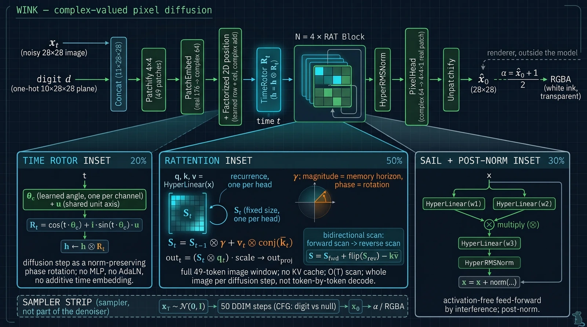

<div align="center">

# WINK<br><sup><small>*或者：没有 latent 辅助轮的扩散*</small></sup>

🇬🇧 [English](README.md) | 🇩🇪 [Deutsch](README.de.md) | 🇨🇿 [Čeština](README.cs.md) | 🇨🇳 **中文** | 🇷🇺 [Русский](README.ru.md)

<a href="https://git.pvlb.dev/ml-lab/wink"> 主仓库 — https://git.pvlb.dev/ml-lab/wink</a><br>
<small>GitHub 镜像: <a href="https://github.com/pvlb-dev/wink" target="_blank">https://github.com/pvlb-dev/wink</a></small>

> 这是 v0.1.0 的中文翻译。以英文 README 为准：[README.md](README.md)。

---

</div>
<br>

### 欢迎来到 **WINK**，一个复值图像生成的微型实验室！

**v0.1.0（开发中）** 是一个**可提示（promptable）MNIST** 扩散模型，可在笔记本 CPU 上运行，
在**透明背景**上用白色墨水作画，并**完全在浏览器中**生成。选一个数字、设定 guidance、
得到一个数字。261k 参数、4 层、RAT-32 —— 没有 VAE、没有 latent 解码器、没有服务器。

> **image geneRATion** —— 来自 TARDITS 的 RAT，从 token 转向像素。

<p align="center">

</p>

RAT 块和超复数层来自
[TARDITS](https://git.pvlb.dev/ml-lab/tardits)（`tardits>=0.3.0`）。它们是同一个
RAT 家族，而不是同一个模型：WINK 增加了 2D patch token、扩散步转子、类别条件和
一个 pixel head。这里的 261k 可提示 checkpoint 是一个 WINK 模型，而不是 100M 的
TARDITS 基座。

<br>

## 🚀 快速上手与用法

### 只是想玩玩？

10k 的可提示权重已经在仓库里了。无需 Python 训练：

```bash
python -m http.server 5001 -d web
# open http://127.0.0.1:5001
```

数字按钮 + guidance 滑块、透明 RGBA 输出、Web Worker 推理。
参见 [`web/README.md`](web/README.md)。

### 安装

```bash
git clone https://git.pvlb.dev/ml-lab/wink.git
cd wink
uv sync --locked --extra mlflow --extra eval
.venv/bin/pytest -q
```

### 训练 0.1 模型（CPU）

浏览器权重背后的 10k 模型在 t14 上约需 46 分钟：

```bash
.venv/bin/wtrain -c examples/configs/mnist_rat_cond_cfg_h32_10k.yaml
```

若想先做一次简单的无条件训练，`examples/configs/mnist_rat.yaml` 约 19 分钟训练 RAT-16。
MNIST 缓存已包含在 `examples/data/`。

### 生成带提示的数字

```bash
.venv/bin/wsample \
  -c examples/configs/mnist_rat_cond_cfg_h32_10k.yaml \
  --checkpoint examples/saved/mnist_rat_cond_cfg_h32_10k/final.pt \
  -n 80 --classes 0,1,2,3,4,5,6,7,8,9 \
  --guidance 5 --alpha --nrow 8 -o prompted.png
```

写出透明的 RGBA 图集和棋盘格预览图。

### 无条件的 alpha 数字

MNIST 是黑底白墨，因此灰度强度**就是**一张 alpha 掩码。原始的 RAT-16 checkpoint
本身已经是一个 alpha 模型：

```bash
.venv/bin/wsample -c examples/configs/mnist_rat.yaml \
  --checkpoint examples/saved/mnist_rat_h16/final.pt \
  -n 64 --alpha -o alpha.png
```

把真正的 MNIST 测试集导出为 RGBA PNG（无需 GIMP）：

```bash
.venv/bin/python docs/scripts/mnist_to_alpha.py --split test
```

### 跟踪运行

```bash
mlflow ui --backend-store-uri sqlite:///mlflow.db
```

<br>

## 🙃 架构

<details>
<summary><b>点击展开 🔻</b></summary>

<br>

<p align="center">

</p>

*WINK 去噪器。数字平面被拼接到噪声图像上；时间转子在 2D 位置之后施加；模型之外的渲染器把 x0 变成 RGBA。*

```text
x0 [B,C,H,W] -> 4x4 patches -> complex patch embedding
             -> + factorised 2D position (+ class plane in v0.1)
             -> time rotor R_t (ported from dagoBERT)
             -> hyper (full complex softmax) | rat (bidirectional fast-weight)
             -> complex head -> x0_hat [B,C,H,W]
```

- **没有 VAE，没有 latent。** 扩散直接在像素空间进行，MNIST 为 28×28，
  CIFAR 为 32×32；样本不好就是去噪器的问题。
- **Patches：** 4×4，因此 MNIST 是 49 个 token，CIFAR 是 64 个。
- **时间：** 一个学习到的复数转子按扩散步旋转 latent；没有单独的绝对时间表。
- **RAT：** 来自 `tardits` 的双向 fast-weight 块，对 64 token 的 CIFAR 窗口使用
  分块扫描。`hyper` 是全 softmax 的对照组。
- **条件（v0.1）：** 在每个 DDIM 步，一个 10 通道的 one-hot 数字平面被拼接到
  噪声图像上；10% 的类别 dropout 给出空分支，而无分类器 guidance（`--guidance`）
  让数字服从提示。这是数字类别条件，不是自由文本：UI 把“seven”映射为 7。
- **层级：** `level` 是一个配置字段（ℂ、ℍ、𝕆、…）。Level 1 是 CPU
  默认值；level 2/3 在 CIFAR 上可行，但在这一规模下投入大于回报。

详细设计、不变量和移植映射：
[`docs/model-internals.md`](docs/model-internals.md)。

</details>

## 🔥 证据与测量

<details>
<summary><b>点击展开 🔻</b></summary>

<br>

### M1 —— MNIST，3k CPU 步

| 模型 | val x0-MSE | 说明 |
|---|---:|---|
| hyper softmax | 0.0801 | 团块状样本 |
| RAT-16 | **0.0629** | 可辨认的数字 |
| RAT-32 | 0.0617 | CPU 首选，217.5 ms/step |

质量在 8–32 个头附近饱和；速度则持续提升。完整表格：
[`mnist-hyper-vs-rat.md`](docs/findings/mnist-hyper-vs-rat.md)、
[`rat-head-sweep.md`](docs/experiments/2026-11-19-rat-head-sweep.md)。

### M2 —— CIFAR-10，10k 步，与 10k 张真实图像对比的 FID

| 模型 | val x0-MSE | FID |
|---|---:|---:|
| hyper 10k | 0.0347 | 160.36 |
| RAT-32 10k | 0.0351 | **156.12** |
| RAT-32 20k cosine | 0.0326 @17k | 178.68 |
| RAT-32 宽度 96，10k | **0.0330** | **149.60** |
| 四元数 level 2，10k | 0.0342 | 170.04 |

诚实的说法：RAT 在 49 个 token 时胜出；CIFAR 只到纹理层面，而非物体层面；
更多步数可以降低 val，却会损害 FID；加宽有帮助，加深和更高层级并非免费的胜利。
报告：
[`2026-11-19-cifar10-10k.md`](docs/experiments/2026-11-19-cifar10-10k.md)、
[`2026-11-20-cifar10-rat-chunked.md`](docs/experiments/2026-11-20-cifar10-rat-chunked.md)、
[`2026-11-20-cifar10-head-sweep.md`](docs/experiments/2026-11-20-cifar10-head-sweep.md)、
[`2026-11-20-cifar10-20k-cosine.md`](docs/experiments/2026-11-20-cifar10-20k-cosine.md)、
[`2026-11-21-cifar10-levels.md`](docs/experiments/2026-11-21-cifar10-levels.md)、
[`2026-11-21-cifar10-param-matched-10k.md`](docs/experiments/2026-11-21-cifar10-param-matched-10k.md)。

### 0.1 —— 可提示 MNIST

| 模型 | 参数量 | 预算 | val x0-MSE |
|---|---:|---:|---:|
| 无条件 RAT-32 | 250k | 3k | 0.0617 |
| 通道 + 类别 dropout + CFG | 261k | 10k | **0.0435** |

带提示的 0–9 网格：
[`prompted_digits_10k_preview.png`](docs/assets/mnist/prompted_digits_10k_preview.png)。
详情：[`2026-11-21-mnist-promptable.md`](docs/experiments/2026-11-21-mnist-promptable.md)。

### 目前尚未奏效的做法

- 0.24M 参数下 1,000 步 / epsilon 预测：高噪声下的 x0 太不准确；采样器停留在
  噪声状态。
- 1,000 步的 v-prediction：陷入平台期。
- 加性正弦时间条件：收敛更慢。
- 等参数下更长的 CIFAR 训练（20k）与四元数 level 2：val 更低，FID 更差。
- 6 层深度对照在笔记本负载下约 1.5 s/step，因此被推迟。

这些都以零结果（null）形式记录在案，而不是被隐藏。

</details>

## 🗺️ 仓库地图与文档

<details>
<summary><b>点击展开 🔻</b></summary>

<br>

```text
src/wink/            models, diffusion, trainer, data, alpha, CLIs
examples/configs/    two entry points: simple MNIST + promptable 10k
examples/data/       MNIST cache (11 MB), committed
examples/saved/      empty; checkpoints written here
docs/                findings, experiments, model internals, repo map
web/                 pure-JS promptable toy + exported weights
tests/               38 tests (no network needed)
AGENTS.d/            private knowledge clone, not tracked here
```

- [`docs/index.md`](docs/index.md) —— 发现与实验索引。
- [`docs/repo-map.md`](docs/repo-map.md) —— 各个部分都在哪里。
- [`docs/findings/alpha-mnist.md`](docs/findings/alpha-mnist.md) —— 无需重训的
  透明数字。
- [`web/README.md`](web/README.md) —— 浏览器推理与 Web 前端集成说明。
- CI 是 Forgejo Actions（`runs-on: docker`），仅手动 dispatch + `master`。

</details>

## 🧭 展望

- **0.1.0：** 打包 CPU MNIST 发布（快速上手、变更日志、tag）。
- **Fashion-MNIST：** 第二个微小数据集，沿用相同的 alpha/可提示流程。
- **RGBA：** 真彩色 + alpha 扩散，而不只是把灰度当作 alpha。
- **CIFAR 容量：** 宽度 128 和一个公平的 level-2 调度；96 宽的运行是目前
  最好的 FID。
- **文本条件** 以及 VAE/latent 变体不在 v0 的范围内。

<br>

## 📜 许可与署名

Apache-2.0；参见 [`LICENSE`](LICENSE)。WINK 是
[TARDITS](https://git.pvlb.dev/ml-lab/tardits) 的图像兄弟项目；RAT 块和超复数
层是共享的，图像模型则是它自己的。
