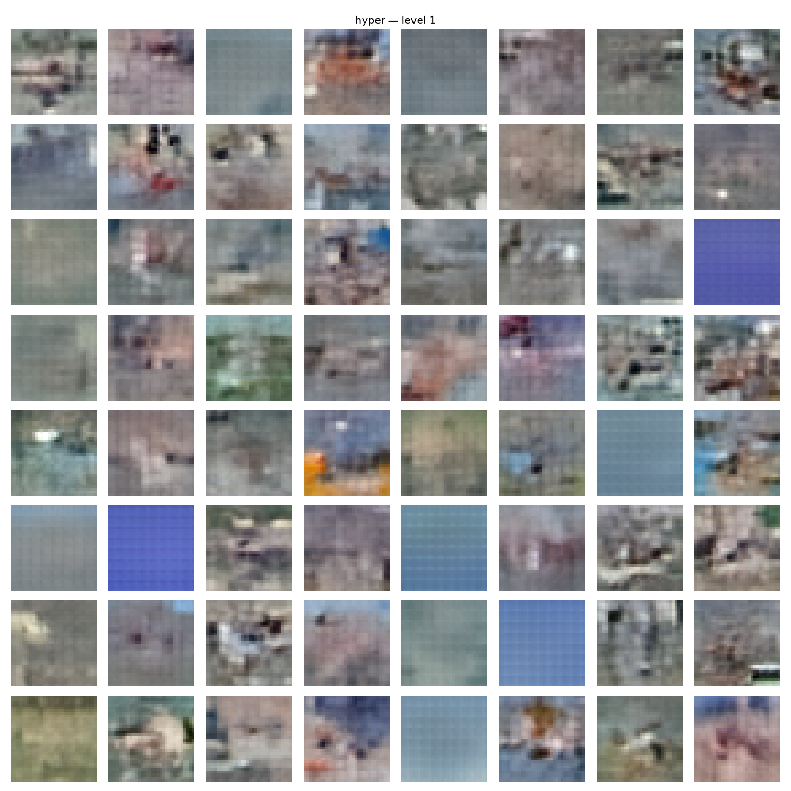

# 2026-11-19 — CIFAR-10 10k-step run

The requested 10k run. The first attempt used RAT-32 and **crashed at step
4000** because its bidirectional scan window shrank below 64 tokens (issue
[#14](https://git.pvlb.dev/ml-lab/wink/issues/14)). The recovery run uses the
hyper softmax fallback, which has no scan-window constraint.

## Protocol

CIFAR-10, 32×32×3, 4×4 patches (64 tokens), class-conditional (`num_classes=10`),
hyper (4 heads, `n_embd=64`, 4 layers), batch 64, 10,000 steps, 200 diffusion
steps, x0 prediction, EMA 0.999, lr 1e-3, seed 1337, DDIM 50 for samples. CPU
(t14), one seed.

## Result

| metric | value |
|---|---|
| params | 249,345 |
| ms/step | 298 |
| wall | 40.2 min |
| train x0-MSE | 0.0337 |
| val x0-MSE | **0.0347** |
| samples | stylized color/texture scenes; no clean objects |
| FID (10,000 samples) | **160.36** |



The 10k model is smoother and more scene-like than the 3k smoke, but it is not a
CIFAR generator yet. It has learned color, horizon and coarse texture statistics.

**Measured FID: 160.36** over 10,000 generated samples against the 10,000-image
CIFAR-10 test split, InceptionV3 dims 2048, DDIM 50. This is far from published
small-diffusion CIFAR numbers and is presented as a baseline, not a competitive
result. The JSON is committed at
[`2026-11-19-cifar10-10k-fid.json`](2026-11-19-cifar10-10k-fid.json).

## The RAT failure (the real finding)

At step 4000 the RAT run raised:

```
ValueError: bidirectional RAT supports windows up to 63 tokens; got 64
```

Tardits derives the scan chunk from the trained `min |gamma|`; after ~4k steps it
becomes 63 while the CIFAR sequence is still 64. The 3k smoke finished just
before the crossover. Fix options (chunked bidirectional scan, a documented
`gamma_min` floor, a 49-token crop) are tracked in #14. Until then, a fair
RAT-vs-hyper CIFAR comparison is blocked.

## FID protocol

- 10,000 generated samples, class labels cycled uniformly over 0–9.
- Reference: the 10,000-image CIFAR-10 test split.
- InceptionV3 features (dims 2048), `pytorch-fid` 0.3.0, CPU.
- Result: **FID 160.36** on 10,000 generated vs 10,000 real CIFAR-10 test images,
  DDIM 50, seed 0, hyper 10k checkpoint.
- Sample count and model/run are recorded in
  [`2026-11-19-cifar10-10k-fid.json`](2026-11-19-cifar10-10k-fid.json).

The FID number is high at this model size and budget. That is the point: it is a
measured baseline, not a claim of competitiveness.

## Artifacts

- MLflow run: `7c91ee25de9b4b3d8dbf5179409843c8` (`wink-cifar10`)
- Failed RAT run: `43d4f09497344a5ba4e69d1967e15585` (`FAILED`)
- Checkpoint: `examples/saved/cifar10_hyper_10k/final.pt` (gitignored)
- Grid: `docs/assets/cifar10/cifar_hyper_10k_64.png`
- Sample/FID workdir: `examples/saved/fid_cifar10_hyper_10k/` (gitignored)

## Next

1. Fix #14 so RAT can do 64-token CIFAR; rerun the head sweep there.
2. A longer run (20k–50k) or a GPU window; 10k CPU steps is still a smoke.
3. Report FID with the sample count in the finding once the number is in.
4. Do not present this as a competitive CIFAR result.
