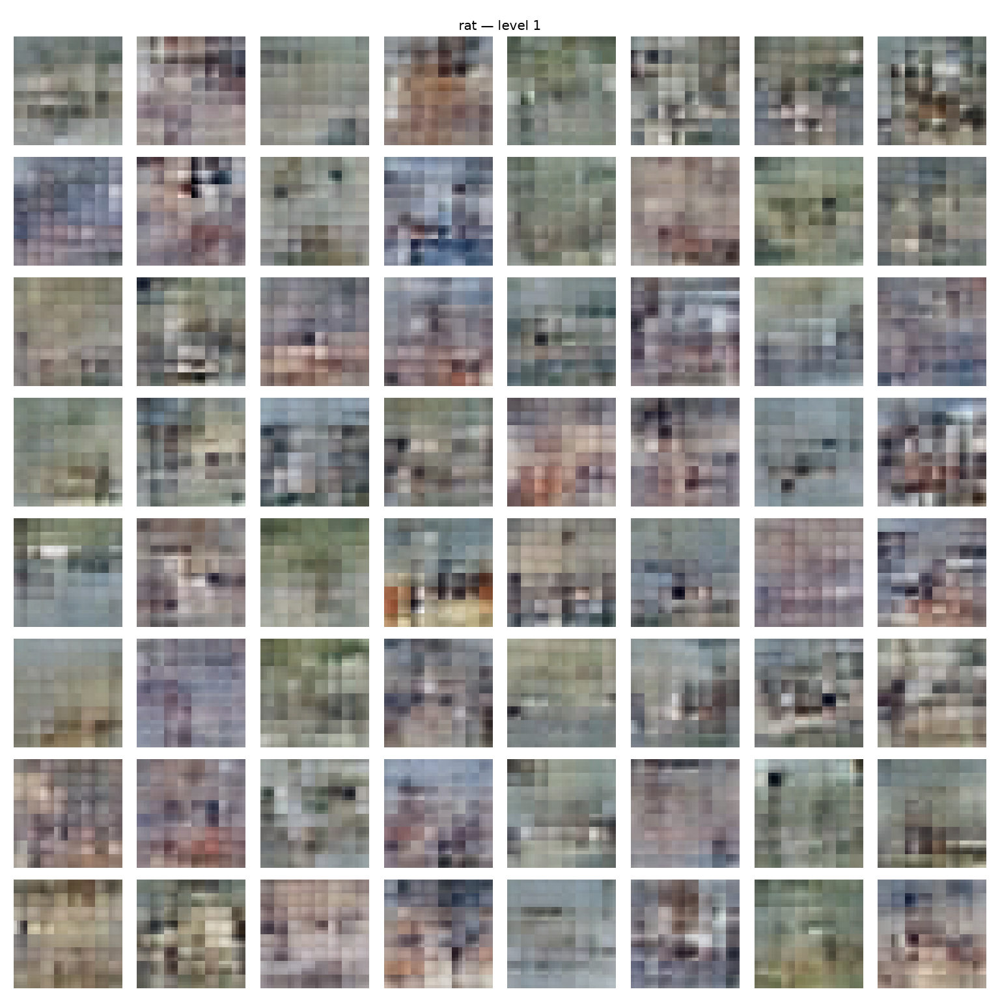

# 2026-11-19 — CIFAR-10 smoke (class-conditional RAT-32)

This is a **pipeline smoke**, not a CIFAR result. The data loader, class
conditioning, 64-token RAT window and MLflow path all work; 3,000 CPU steps are
far too few for object-like samples.

## Protocol

CIFAR-10, 32×32×3, 4×4 patches (64 tokens), class-conditional (`num_classes=10`),
RAT-32 (head size 2 at `n_embd=64`), 4 layers, batch 64, 3,000 steps, 200
diffusion steps, x0 prediction, EMA 0.999, lr 1e-3, seed 1337, DDIM 50 for
samples. CPU (t14), one seed.

## Result

| metric | value |
|---|---|
| params | 250,369 |
| ms/step | 356 |
| wall | 18.1 min |
| train x0-MSE | 0.0426 |
| val x0-MSE | **0.0427** |
| samples | blurry color fields; no recognizable objects |
| FID | not computed |

The sample grid cycles class labels 0–9, so the class path is exercised. At this
budget the model has learned low-frequency color statistics, not objects.

## Why this is not a CIFAR result

- 3,000 steps × 64 = 192k samples ≈ 4 epochs over 50k images. CIFAR diffusion
  models are normally trained for tens of thousands to hundreds of thousands of
  steps.
- No FID. The M2 acceptance needs ≥10,000 generated samples and a stated sample
  count; that run is deferred to an accelerator window.
- One seed, one config. The h8/h32 head tie is unresolved for CIFAR.

## What is ready

- `examples/configs/cifar10_rat.yaml` — class-conditional RAT-32, 64 tokens.
- `examples/configs/cifar10_hyper.yaml` — hyper smoke variant.
- CIFAR loader verified: 50,000 train / 10,000 test, labels 0–9, pixels in
  [-1, 1].
- The RAT adapter handles the 64-token window; no chunk overflow.

## Next

1. A longer CIFAR run (10k–50k) or a GPU window; report FID with ≥10k samples.
2. Head sweep on CIFAR at the longer budget (h8/h16/h32).
3. If the time rotor remains weak at 32×32, test AdaLN as a recorded ablation.
4. Keep the MNIST result as the M1 claim; do not present the CIFAR smoke as a
   benchmark.

## Artifacts

- MLflow run: `02f4c0951b9648c6b494962f2f528323`
- Grid: `docs/assets/cifar10/cifar_smoke_64.png`
- Config: `examples/configs/cifar10_rat.yaml`
- Checkpoint: `examples/saved/cifar10_rat_h32/final.pt` (gitignored)
