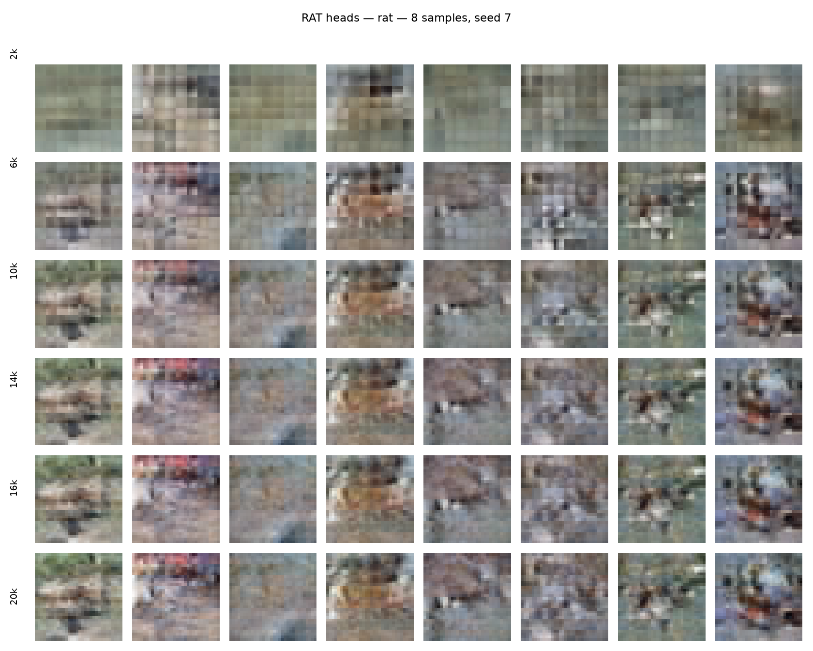
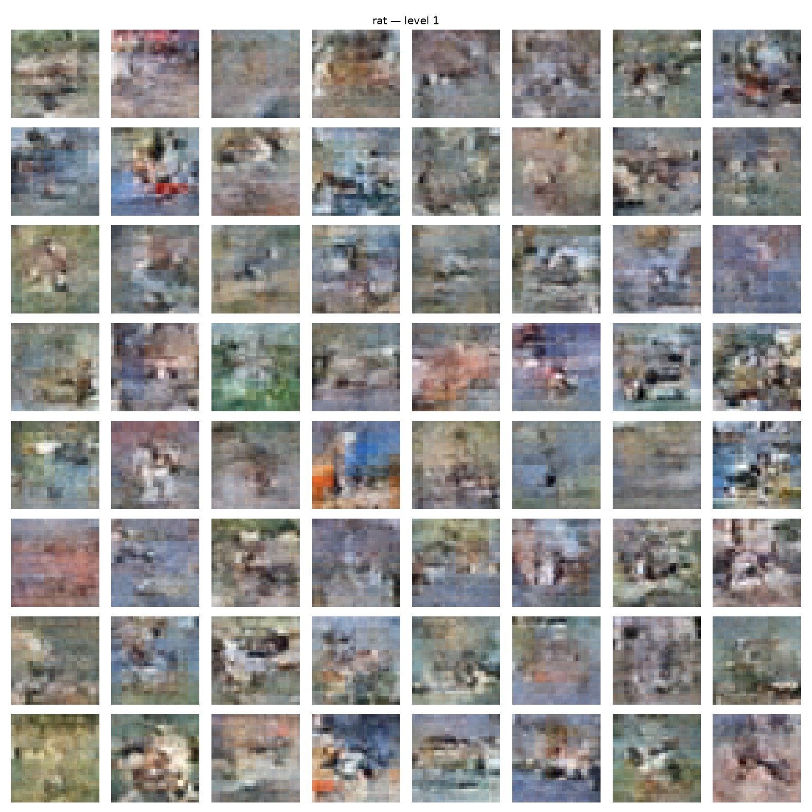

# 2026-11-20 — CIFAR-10 RAT-32 20k with cosine LR

The first longer run. Same architecture and data as the 10k RAT-32 run; the
budget doubles and the learning rate decays from 1e-3 to 1e-4 instead of staying
constant.

## Protocol

CIFAR-10, 32×32×3, 4×4 patches (64 tokens), class-conditional
(`num_classes=10`), RAT-32, 4 layers, `n_embd=64`, chunked bidirectional scan,
batch 64, 20,000 steps, 200 diffusion steps, x0 prediction, EMA 0.999, cosine LR
1e-3 → 1e-4, seed 1337, DDIM 50. CPU, one seed.

## Result

| metric | value |
|---|---|
| params | 250,369 |
| wall | 131.8 min |
| val x0-MSE (final 20k) | 0.0347 |
| val x0-MSE (best, 17k) | **0.0326** |
| val x0-MSE (16k checkpoint) | 0.0336 |
| samples | see progression below |
| FID (10k, 16k ckpt) | **178.68** |

## Learning progression

8 samples per checkpoint, same seed and class labels:

The big jump is 2k -> 6k: flat color fields become textured scenes. From 6k to
20k the *character* barely changes; val loss still falls (0.0370 -> 0.0326) but
the samples plateau. The 17k step had the best val loss; 18k/20k drifted up
(0.0347 at 20k), so the final checkpoint is not automatically the best one.

**The 16k checkpoint has a worse FID than the 10k run: 178.68 vs 156.12** on the
same 10k/10k protocol. Lower val x0-MSE did not translate into better samples.
This is the clearest result of the long run: **stop buying steps; buy capacity or
better data/architecture.** The 10k constant-LR checkpoint remains the best FID
model.

## Why cosine

The 10k runs used a constant 1e-3 and were still improving slowly at the end.
Cosine decay is the standard long-run default: high LR early, low LR late. It is
a change to the recipe, so it is recorded explicitly; the 10k constant-LR runs
remain the baseline.

## Caveats

- One seed, 0.25M params; still a tiny model by CIFAR standards.
- FID is measured on the 16k checkpoint (best saved val), 10k samples, same
  real reference as the 10k run. The final 20k checkpoint is worse on val.
- The 20k run uses cosine LR, so it is not a pure step-count comparison; the
  FID regression is large enough that the conclusion does not depend on that.
- Checkpoint retention was necessary: 17k was the best val but was not saved
  (save interval 2k); do not assume the final checkpoint is best.

## Artifacts

- MLflow: `e9a7a3730e5247f0b92561f3a852291c` (`wink-cifar10`).
- Checkpoint: `examples/saved/cifar10_rat_h32_20k/final.pt` (gitignored)
- Grids: `docs/assets/cifar10/cifar_rat_20k_step16k_64.png`,
  `docs/assets/cifar10/cifar_20k_progression.png`.
- FID JSON: [`2026-11-20-cifar10-20k-fid.json`](2026-11-20-cifar10-20k-fid.json).
