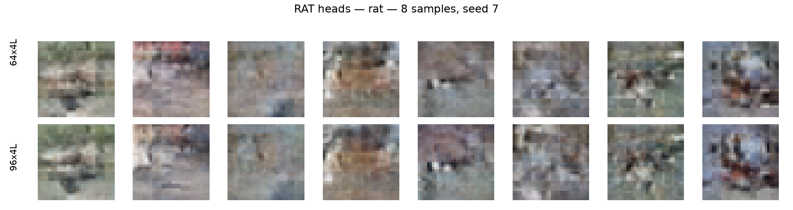

# 2026-11-20 — CIFAR-10 RAT capacity experiments

The 20k run showed the 0.25M model is capacity-limited, not step-limited. This
is the capacity sweep: wider first, then a depth control at fixed width.

## Reference

The current model is **4 layers, `n_embd=64`, 32 heads** (head size 2),
250,369 params. On CIFAR-10 at 10k steps it reached val x0-MSE 0.0351 and FID
156.12. That is the baseline.

## Design

RAT's only position signal is the learned complex decay, so depth may matter
more than in a RoPE/absolute-position transformer: each block re-applies a
distance-decayed memory. The sweep therefore separates width from depth:

| run | layers | n_embd | heads | head size | params | status |
|---|---:|---:|---:|---:|---:|---|
| baseline | 4 | 64 | 32 | 2 | 250,369 | done, FID 156.12 |
| w96_4l | 4 | 96 | 48 | 2 | 547,585 | **done**: val 0.0330, FID **149.60** |
| w128_4l | 4 | 128 | 64 | 2 | 959,489 | planned |
| w96_6l | 6 | 96 | 48 | 2 | 809,473 | deferred (CPU: ~1.5 s/step, 4h for 10k) |

All use the 10k constant-LR recipe (T=200, x0, EMA 0.999, batch 64), so the
capacity comparison is not confounded by the cosine schedule.

## Results

w96_4l: val x0-MSE **0.0330**, FID **149.60** over 10k samples, 102.7 min,
547,585 params. The baseline was 0.0351 / 156.12. Width helps: **-4.2% FID**
and a clear val improvement. The 64-sample grid is
`docs/assets/cifar10/cifar_rat_w96_4l_64.png`; FID JSON is
[`2026-11-20-cifar10-w96-fid.json`](2026-11-20-cifar10-w96-fid.json).

The 6-layer / same-width control (w96_6l) was stopped at 1k: under the current
laptop load it ran at ~1.5 s/step, i.e. ~4h for the 10k budget. Its 1k val
(0.0516) was indistinguishable from w96_4l at 1k (0.0515), so there is no early
depth signal either. Depth is the next run when the CPU is free; it is not
abandoned, just not bought at this load.

## Hypothesis and falsification

- **Width is a lever: confirmed.** 4L 64 -> 96 lowers FID 156.12 -> **149.60**
  (-4.2%) and val 0.0351 -> 0.0330 at the same 10k budget. The visual difference
  is subtle; the metric is the evidence.
- **Depth is not yet measured.** The 6L control did not fit the current CPU
  window; 1k val was a tie. RAT's decay is the only position signal, so depth
  remains a legitimate open question.
- More width (128) is the next cheap-ish test; more depth at 10k needs a free
  machine or a smaller budget screen.

## Artifacts

Checkpoints under `examples/saved/cifar10_rat_<run>/`, grids in
`docs/assets/cifar10/`, MLflow experiment `wink-cifar10`.
