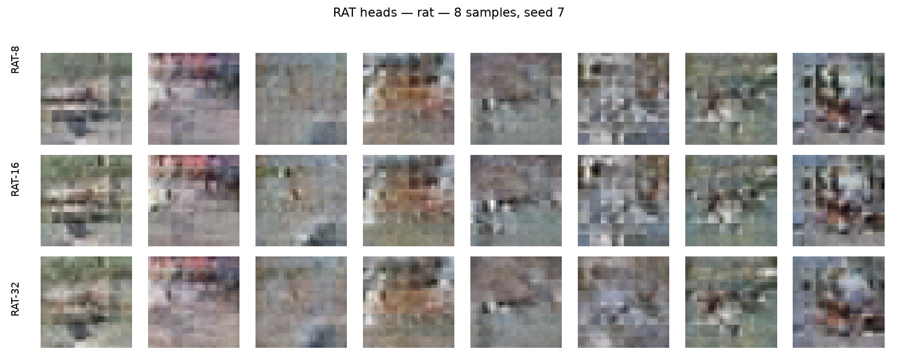

# 2026-11-20 — CIFAR-10 RAT head sweep at 10k

Question: does the number of RAT heads change sample character at 64 tokens, and
does the MNIST h32 speed advantage survive on CIFAR-10?

## Protocol

CIFAR-10, 32×32×3, 4×4 patches (64 tokens), class-conditional
(`num_classes=10`), RAT, 4 layers, `n_embd=64`, batch 64, 10,000 steps, 200
diffusion steps, x0 prediction, EMA 0.999, lr 1e-3, seed 1337, DDIM 50. CPU
(t14), one seed. The chunked bidirectional scan is required; without it the run
dies at ~4k (#14).

## Result

| RAT heads | head size | state | params | ms/step (bench) | wall | val x0-MSE | FID (10k) |
|---:|---:|---:|---:|---:|---:|---:|---:|
| 8 | 8 | 512 | 253,441 | 568 | 114.4 min | 0.0356 | not run |
| 16 | 4 | 256 | 251,393 | 350 | 71.7 min | 0.0353 | not run |
| 32 | 2 | 128 | 250,369 | 356 | 59.7 min | **0.0351** | **156.12** |

Wall times were taken on a shared laptop; the load varied, so the benchmark
column is the cleaner speed signal. The 10k h32 run is the one with FID; h8/h16
FID was not measured.

## Visual comparison

8 samples per head, same seed and class labels:

The rows are close. At this model size and budget, **head count changes speed
much more than visual character**: all three produce the same family of blurry
color/texture scenes. h8 is perhaps a touch smoother/coarser; h32 is not
visually dramatic.

Full 64-sample grids:

- [RAT-8](../assets/cifar10/cifar_rat_h8_10k_64.png)
- [RAT-16](../assets/cifar10/cifar_rat_h16_10k_64.png)
- [RAT-32](../assets/cifar10/cifar_rat_h32_10k_64.png)

## Conclusion

- **h32 remains the CPU pick**: fastest wall time, marginally best val loss, and
  the only head count with a measured FID (156.12).
- h16 is close on quality but slower in this run; h8 is clearly the slowest and
  has no quality advantage.
- The MNIST result ("quality saturates, speed improves") transfers to CIFAR at
  this scale.
- Do not overclaim: the val-loss spread is ~1.4% and one seed; the visual
  difference is small.

## Artifacts

| run | MLflow id |
|---|---|
| RAT-8 10k | `adcece52af22494ca59e563dd4ff4274` |
| RAT-16 10k | `e6d2bb9f7c9647959eb6b4172abe3cf2` |
| RAT-32 10k chunked | `74955807cc524e2e8bf8ada1a8ec1513` |

Comparison script: [`../../docs/scripts/compare_rat_heads.py`](../scripts/compare_rat_heads.py).

## Next

1. Second seed for h16/h32; the gap is small.
2. FID for h8/h16 only if a seed effect is ruled out.
3. A longer/GPU run for object-like samples; 0.25M/10k CPU is the bottleneck.
