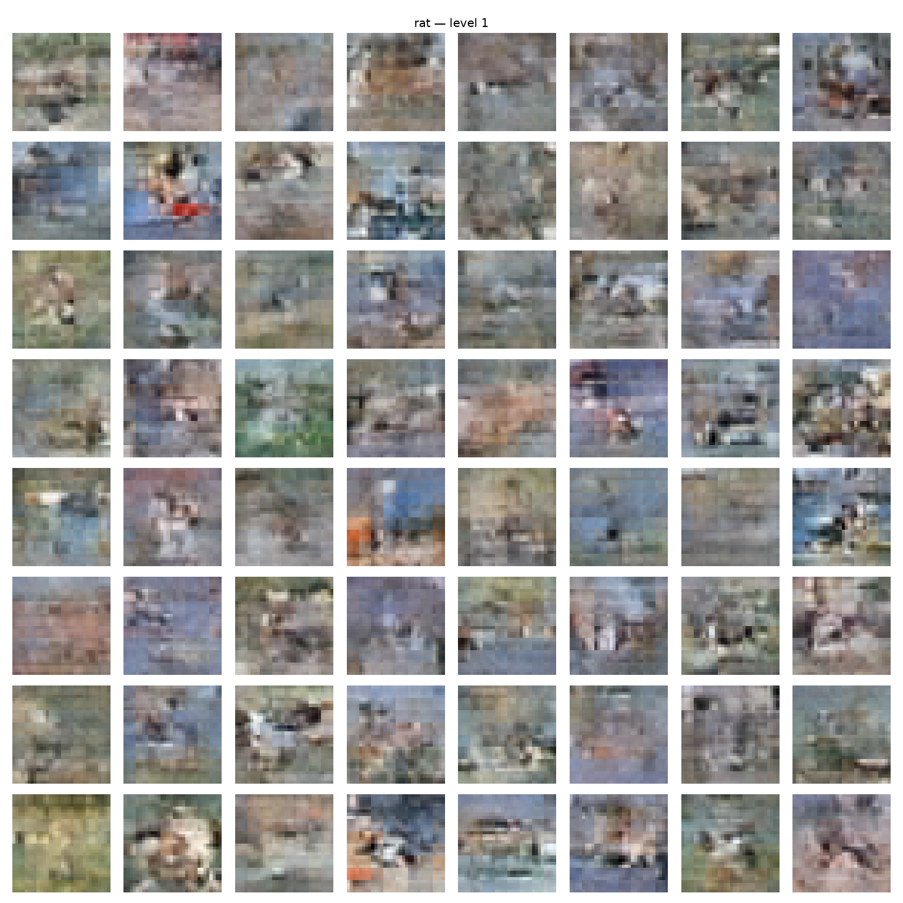

# 2026-11-20 — CIFAR-10 RAT-32 10k with the chunked scan

Follow-up to the RAT 64-token failure (#14). The stock tardits bidirectional
block rejects `T > chunk`; WINK now carries state across chunks. This is the
first RAT CIFAR run that survives the gamma crossover.

## Fix

`ChunkedBidirectionalRattention` (src/wink/models/rat.py):

- for `T <= chunk`, delegates to stock tardits — MNIST behavior is unchanged;
- for `T > chunk`, computes the forward and reversed scans in safe chunks,
  carrying `S_last` between chunks, then applies `S_fwd + S_bwd - A_self`;
- tests: chunked vs full scan max diff ~2.3e-6; 64 tokens with gamma×0.35
  forwards finite; RATDiT CIFAR forward after forced gamma decay works.

## Protocol

CIFAR-10, 32×32×3, 4×4 patches (64 tokens), class-conditional (`num_classes=10`),
RAT-32 (head size 2 at `n_embd=64`), 4 layers, batch 64, 10,000 steps, 200
diffusion steps, x0 prediction, EMA 0.999, lr 1e-3, seed 1337, DDIM 50. CPU,
one seed.

## Result

| metric | RAT-32 | hyper 10k (reference) |
|---|---:|---:|
| params | 250,369 | 249,345 |
| wall | 59.7 min | 40.2 min |
| train x0-MSE | 0.0341 | 0.0337 |
| val x0-MSE | **0.0351** | **0.0347** |
| FID (10k samples) | **156.12** | 160.36 |

RAT survives the 10k run and matches hyper on val loss within one-seed noise.
With the same 10k/10k FID protocol, RAT is slightly lower: **156.12 vs 160.36**
(about 2.6%). Both are far from competitive CIFAR numbers; treat this as a
first signal, not a win. RAT samples look a little more textured than hyper's.

## Artifacts

- MLflow run: `74955807cc524e2e8bf8ada1a8ec1513` (`wink-cifar10`).
- FID JSON: [`2026-11-20-cifar10-rat-10k-fid.json`](2026-11-20-cifar10-rat-10k-fid.json).
- Checkpoint: `examples/saved/cifar10_rat_h32_10k_chunked/final.pt` (gitignored).
- Grid: `docs/assets/cifar10/cifar_rat_10k_64.png`.
- FID workdir: `examples/saved/fid_cifar10_rat_10k_chunked/` (gitignored).

## Caveats

- One seed, 10k CPU steps; still far from a competitive CIFAR model.
- The chunked scan is mathematically equivalent but not bit-identical to the
  full scan; the test bounds the difference.
- Do not claim RAT > hyper on CIFAR until the FID is in and the sample count is
  stated.

## Next

1. Run the CIFAR head sweep (h8/h16/h32) at 10k; the MNIST sweep said h32 is
   fastest, and the CIFAR FID gap is small enough that a second seed matters.
2. Longer/GPU budget for object-like samples; 0.25M/10k is not enough.
3. Keep the MNIST RAT-32 claim separate from this dataset-scaling baseline.
