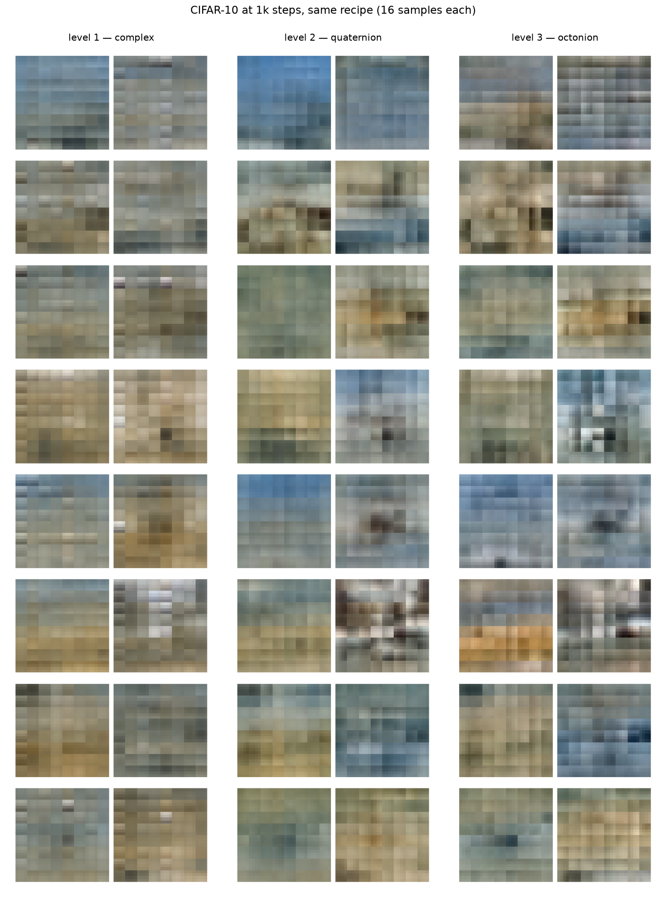

# 2026-11-21 — CIFAR-10 RAT at level 2 and level 3

First test of the quaternion (level 2) and octonion (level 3) algebras on
images. The question is deliberately small: **do they work at all, and how do
they compare at a matched-ish budget?**

## Setup

CIFAR-10, 32×32×3, 4×4 patches (64 tokens), class-conditional, RAT-32,
4 layers, T=200, x0, EMA 0.999, constant lr 1e-3, DDIM 50. The level 1 baseline
is the 4L × 64, 32-head model.

| level | algebra | params | steps | batch | wall |
|---:|---|---:|---:|---:|---:|
| 1 | complex ℂ | 250,369 | 1k / 3k | 64 | 60 min for 10k (ref) |
| 2 | quaternion ℍ | 500,099 | 3,000 | 64 | 78.2 min |
| 3 | octonion 𝕆 | 999,559 | 1,000 | 32 | 48.6 min |

Level 3 at batch 64 was ~5.1 s/step, so the screen used batch 32 (~2.2 s/step)
and a 1k budget. The level 3 comparison is therefore **not** a clean matched
capacity test.

## Result: both algebras work

No NaNs, no collapse, no shape errors. The hypercomplex path, CD multiplication,
SAIL, the time rotor, the chunked bidirectional scan and the patch head all run
at level 2 and 3.

| model | 1k val x0-MSE | 3k val x0-MSE |
|---|---:|---:|
| level 1, 250k | 0.0589 | 0.0426 |
| level 2, 500k | 0.0505 | **0.0403** |
| level 3, 1M (batch 32) | 0.0506 | not run |

Both level 2 and level 3 are **better than level 1 at 1k**, but they also have
2× and 4× the parameters; level 2's 3k val (0.0403) beats level 1's 3k (0.0426)
by ~5%, but not enough to claim the algebra is the cause.

The visual character is similar: smooth color/texture fields. Level 2/3 look a
little less noisy than level 1 at 1k, consistent with the larger parameter count.
No object-level difference at this budget.

Full 64-sample grids:

- [level 2, 3k](../assets/cifar10/cifar_rat_l2_3k_64.png)
- [level 3, 1k](../assets/cifar10/cifar_rat_l3_1k_64.png)

## Cost

| level | ms/step (batch 64) | 10k estimate |
|---:|---:|---:|
| 1 | ~360 | 60 min |
| 2 | 1,386 | ~3.9 h |
| 3 | 5,128 | ~14 h (batch 32: ~2.2 s/step) |

Level 3 is a research toy on CPU, not a practical training target. A clean
algebra comparison needs parameter matching (e.g. level 2 at ~45 width, level 3
at ~32 width) and the same batch/step budget.

## Verdict

- **Quaternion/octonion image diffusion works.** That was the open question.
- Level 2 is trainable on CPU in ~1.3 h for 3k steps and is slightly better than
  level 1 at matched steps, but with 2× params. Promising, not proven.
- Level 3 runs but is ~14× the level-1 step cost at batch 64; keep it as a
  small-budget curiosity unless a GPU window appears.
- Next: a parameter-matched level-1/2 comparison at 10k, or level 2 at 10k with
  FID, is the only way to say whether the algebra itself helps.

## Artifacts

| run | MLflow id |
|---|---|
| level 2, 3k | `a8dd9ee62a014a2fa94e0b65ba265c95` |
| level 3, 1k | `7837283be013416ab3da6de1d33df9c2` |

Configs: `docs/experiments/configs/cifar10_rat_l2_3k.yaml`,
`docs/experiments/configs/cifar10_rat_l3_1k.yaml`.
Grids: `docs/assets/cifar10/cifar_rat_l2_3k_64.png`,
`cifar_rat_l3_1k_64.png`, `levels_1k_compare.png`.
