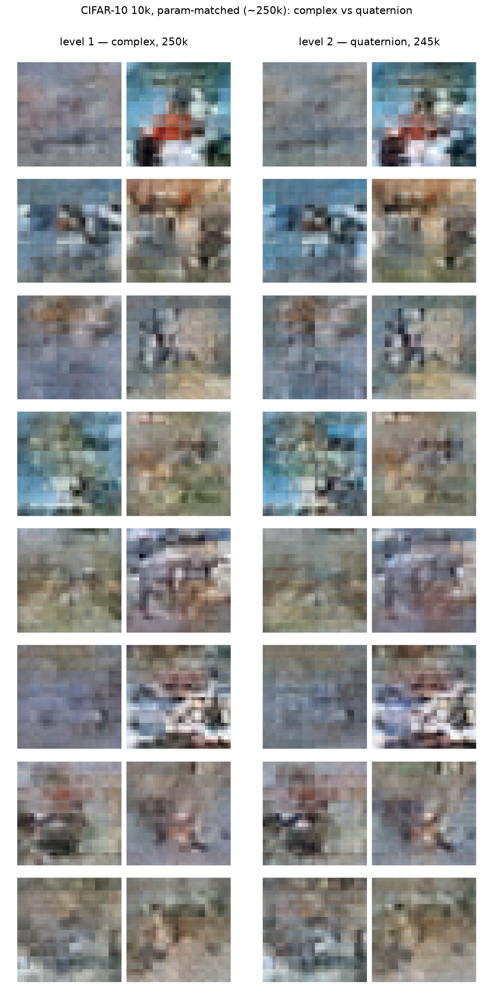

# 2026-11-21 — param-matched level 2, 10k + FID

The decisive follow-up to the 3k screen: same parameter count, same 10k budget,
same FID protocol as the level 1 baseline (156.12).

## Match and protocol

| model | level | n_embd | heads | params |
|---|---:|---:|---:|---:|
| baseline | 1 | 64 | 32 | 250,369 |
| **quaternion** | **2** | **44** | **22** | **245,259** |

CIFAR-10, 64 tokens, class-conditional, 4 layers, T=200, x0, EMA 0.999, constant
lr 1e-3, batch 64, 10,000 steps, DDIM 50 for sampling. One seed.

## Result

| metric | level 1 | level 2 |
|---|---:|---:|
| params | 250,369 | 245,259 |
| val x0-MSE | 0.0351 | **0.0342** |
| wall | 59.7 min | 163.5 min |
| FID (10k) | **156.12** | **170.04** |

Level 2 is **~2.6% lower val** at 10k with 2% fewer parameters, and ~2.7×
slower. But its FID is **170.04 vs 156.12** on the same 10k/10k protocol: the
quaternion model is **worse on sample quality** despite the lower regression
loss.

This is the decisive answer: at equal parameters and a 10k budget, quaternion
level 2 does **not** keep the 3k val edge. The 4% val gap at 3k was early-budget
noise. Val x0-MSE is not a sample-quality metric; FID is.

## Why this was the decisive run

The 3k screen showed level 2 ~4% better on val with 2% fewer parameters. A 4%
gap at 3k can be seed noise and a short-budget artefact. The 10k FID decided it:
level 2 loses by 14 FID points and costs ~2.7× the wall time.

## Verdict

- **Complex level 1 remains the practical choice.** At equal params it has the
  better FID and is much faster.
- **Quaternion level 2 works, but is not a free win.** It can fit the regression
  loss better while producing worse samples; this is the same val/FID divergence
  seen in the 20k cosine run.
- A different LR/width/schedule might change the quaternion result, but the
  burden of proof is now on level 2, not level 1.
- Level 3 remains a curiosity; level 1/2 are the practical range, as the
  operator suspected.

## Artifacts

- MLflow: `1243deb7f15e491e8062b3da11d4323c` (`wink-cifar10`).
- Checkpoint: `examples/saved/cifar10_rat_l2_w44_10k/final.pt` (gitignored)
- Grid: `docs/assets/cifar10/cifar_rat_l2_w44_10k_64.png`
- FID: `170.04`; JSON `docs/experiments/2026-11-21-cifar10-l2-w44-fid.json`
