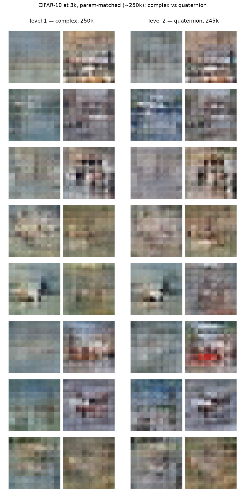

# 2026-11-21 — CIFAR-10 param-matched level 1 vs level 2

The first level 2 run used `n_embd=64` and had 2× the parameters of the level 1
baseline, so it could not answer whether the quaternion algebra itself helps.
This run narrows level 2 to match the parameter count.

## Match

| model | level | layers | n_embd | heads | head size | params |
|---|---:|---:|---:|---:|---:|---:|
| baseline | 1 | 4 | 64 | 32 | 2 | 250,369 |
| **quaternion** | **2** | **4** | **44** | **22** | **2** | **245,259** |

The level 2 model has 2.0% fewer parameters (the hyper_dim=2 doubles the
hypercomplex weight size, so the width compensates). Same token count, patch
size, class conditioning, T=200, x0, EMA 0.999, constant lr 1e-3, 3,000 steps.

## Result

| model | val x0-MSE | wall |
|---|---:|---:|
| level 1, 250k | 0.0426 | ~18 min (3k share of 10k) |
| **level 2, 245k** | **0.0409** | 47.4 min |

Level 2 is **~4% lower val x0-MSE at the same parameter count**. One seed and a
small budget; a 4% gap is a signal, not proof.

The samples are visually close: both are color/texture fields; level 2 is
perhaps slightly smoother. No object emergence at 3k either way.

## Cost

Same parameter count, but level 2 is ~2.6× slower per step on CPU (hypercomplex
multiply). At 10k, the level 2 run would be ~2.5 h vs ~60 min for level 1.

## Verdict

- With parameters held fixed, **quaternion level 2 is slightly better on val
  loss** than complex level 1.
- The effect is small; a 10k run with FID is required before claiming the
  algebra is the cause.
- Level 2 is not a free win at equal params: it costs ~2.6× the step time.
- Level 3 remains outside a fair CPU comparison (1M params at width 64 and
  ~14× step cost).

## Artifacts

- MLflow: `ba63e051e58745aa92bef2fe09a9967d` (`wink-cifar10`)
- Grid: `docs/assets/cifar10/cifar_rat_l2_w44_3k_64.png`
- Comparison: `docs/assets/cifar10/levels_param_matched_3k.png`
- Config (3k screen): `examples/configs/cifar10_rat_l2_w44_3k.yaml`.
- 10k config ready: `examples/configs/cifar10_rat_l2_w44_10k.yaml`.

## Next

1. Same param-matched pair at 10k with FID (level 1 FID is 156.12).
2. If level 2 wins there, try the quaternion-per-pixel alpha idea later (#20).
