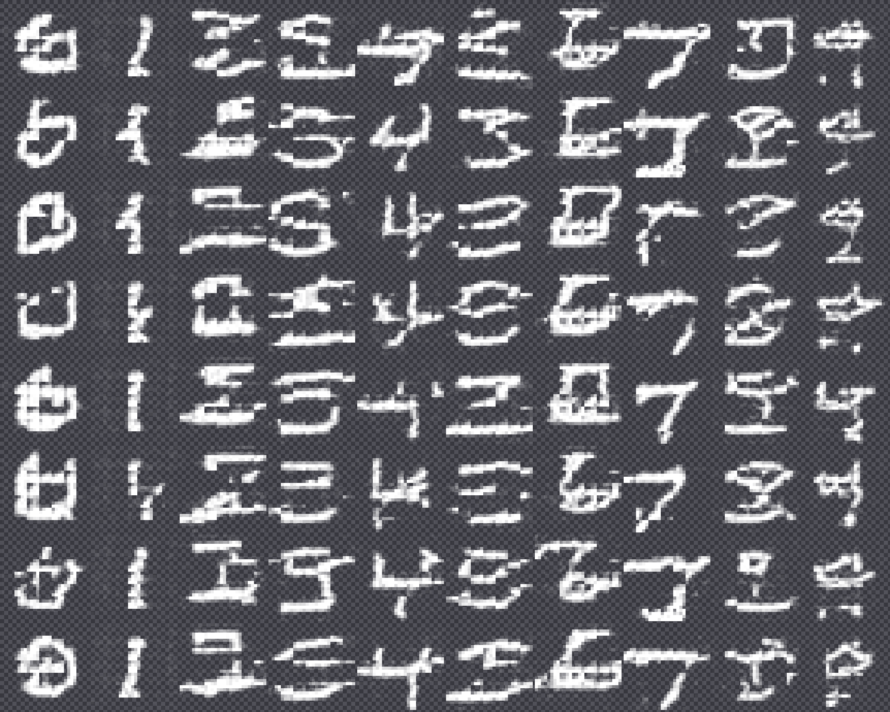

# 2026-11-21 — promptable MNIST digits

Goal: make the alpha MNIST generator **steerable** — ask for a digit and get
that digit. This is the 0.1 promptable model.

## How the conditioning works

The condition is not a one-time “text context before the loop”. It is fed to the
denoiser **at every DDIM step**, together with the noisy image `x_t` and the
timestep `t`:

```text
x0_hat = model(x_t, t, digit)
```

Three ways to inject the digit were tested:

| variant | mechanism | result |
|---|---|---|
| additive | learned complex class code added to every patch token | trains, but weak: samples ignore the class |
| class token | one learned token prepended to the 49 patches | **no gradient**: the class embedding stayed at its init norm; removed |
| **channel** | 10-channel one-hot digit plane concatenated to the input image | best val and the only one that becomes steerable with guidance |

The channel variant is the one used. The model input is `[x_t, onehot(digit)]`
(11 channels total); the output is still one grayscale channel. The digit plane
is a constant image, so it is visible to every patch at every denoising step.

For **classifier-free guidance**, 10% of training labels were replaced by a null
label (all-zero plane). At sampling the model evaluates the conditional and null
predictions and extrapolates:

```text
pred = pred_null + guidance * (pred_cond - pred_null)
```

`guidance=1` is off; `guidance=5` is the promptable setting below. This is the
standard CFG trick and it is what finally made the digits obey the prompt.

## Results

RAT-32, 4 layers, 49 tokens, T=200, x0, EMA 0.999, batch 64, constant lr 1e-3.

| model | steps | val x0-MSE | promptable |
|---|---:|---:|---|
| unconditional RAT-32 (M1) | 3,000 | 0.0617 | n/a |
| additive class code | 3,000 | 0.0633 | no |
| additive class code | 10,000 | 0.0448 | no |
| channel one-hot | 3,000 | 0.0566 | partly |
| channel one-hot | 10,000 | 0.0436 | partly |
| **channel + class dropout + CFG** | **3,000** | **0.0580** | **yes** |

The CFG 3k run is the 0.1 model: 261,121 params, 14.5 min CPU. The 10k channel
checkpoint has the best val but was trained without class dropout, so it cannot
do CFG; it remains a baseline. A 10k CFG run is the next quality step if needed.

## Prompted result

8 samples per digit, digits 0–9 across the columns, `guidance=5`:



Command:

```bash
.venv/bin/wsample -c examples/configs/mnist_rat_cond_cfg_h32.yaml \
  --checkpoint examples/saved/mnist_rat_cond_cfg_h32/final.pt \
  -n 80 --classes 0,1,2,3,4,5,6,7,8,9 \
  --guidance 5 --alpha --nrow 8 -o prompted.png
```

The columns are class-consistent (0s are 0-like, 7s are 7-like), with the usual
small-model distortions. Guidance can be raised for stronger adherence at the
cost of diversity.

## Limits

- 3k steps, 0.26M params; digits are readable but rough.
- White ink only; colour needs the later RGBA model (#20).
- Guidance doubles the denoiser calls per step, which matters for the JS toy but
  is still cheap at 49 tokens.
- This is digit-class conditioning, not free text. “seven” maps to class 7 in
  the UI; real text prompts need a text encoder.

## Artifacts

- MLflow: query `wink-mnist` for `rat-cond-cfg-h32-x0-t200-ema`.
- Config: `examples/configs/mnist_rat_cond_cfg_h32.yaml`.
- Grid: `docs/assets/mnist/prompted_digits.png` + checkerboard preview.
- Failed variants: `mnist_rat_cond_h32*` (additive), `mnist_rat_cond_channel_h32*`
  (channel without CFG).
