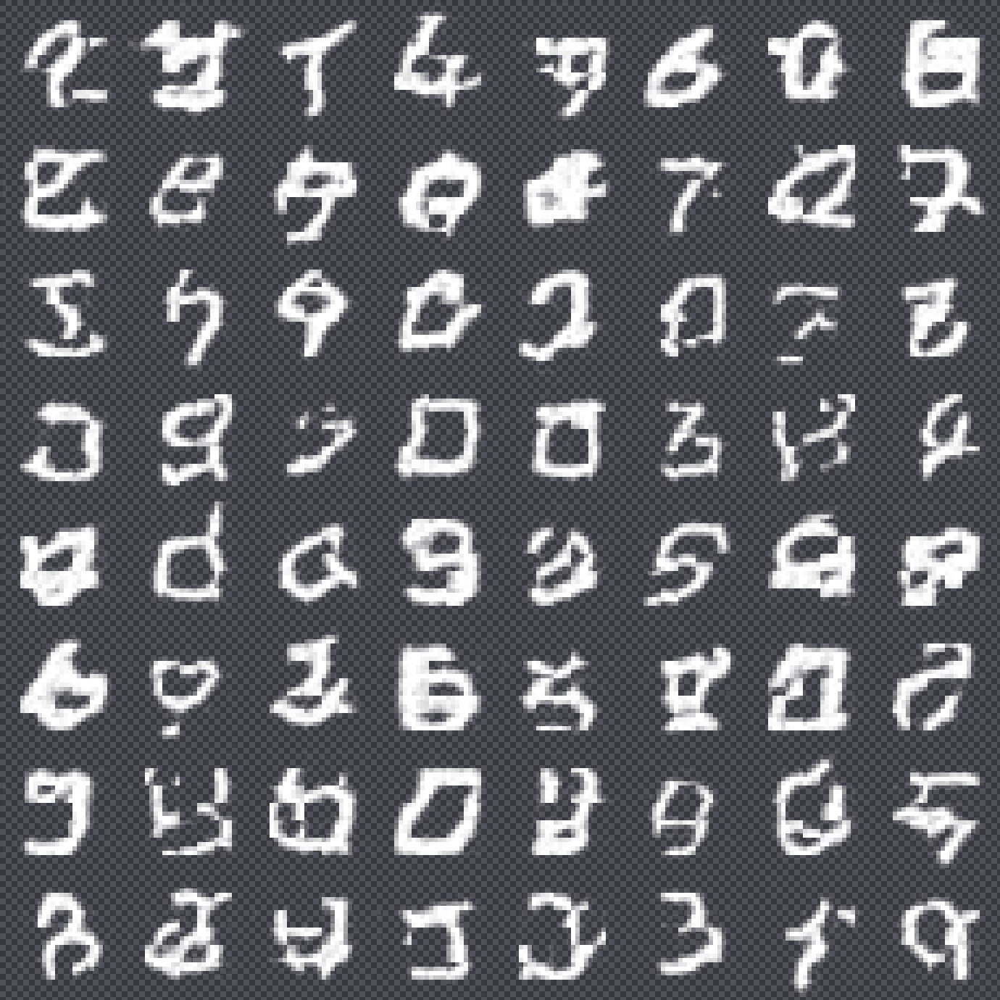
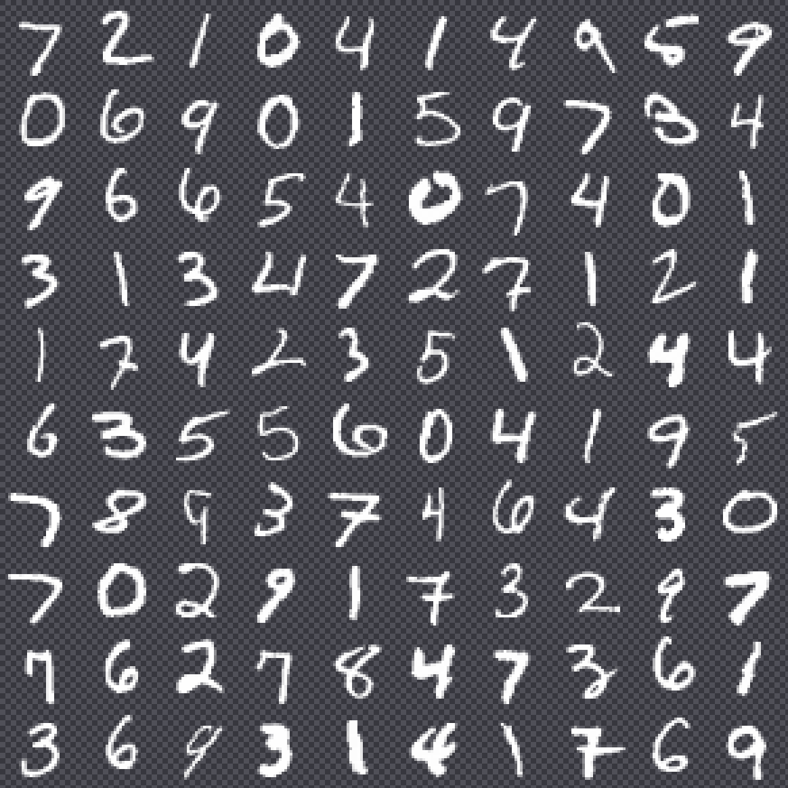

# Alpha MNIST — digits on a transparent background

MNIST is white ink on a black background, so **the grayscale intensity is already
an alpha mask**: 0 is background, 1 is ink. That means the existing MNIST denoiser
is already an alpha model; no retraining and no edited dataset are required. We
only change the renderer and the export path.

This is the 0.1 eyecatcher: every MNIST tutorial produces a black square; WINK
produces a transparent PNG that can be composited anywhere.



## Commands

Generated samples, white ink on transparent background:

```bash
.venv/bin/wsample -c examples/configs/mnist_rat.yaml \
  --checkpoint examples/saved/mnist_rat_h16/final.pt \
  -n 64 --alpha --nrow 8 -o docs/assets/mnist/alpha_digits.png
```

This writes:

- `alpha_digits.png` — RGBA, transparent background, white ink;
- `alpha_digits_preview.png` — the same sheet composited on a dark checkerboard.

Export the real MNIST test set as RGBA PNGs (no GIMP, no manual editing):

```bash
.venv/bin/python docs/scripts/mnist_to_alpha.py --split test
```

Outputs `examples/data/mnist_alpha/test/000000_7.png`, … plus a first-100 sheet.
Use `--limit 100` for a quick look, `--split train` for the training split.



## What is generated vs what is exported

- The **model** is the normal MNIST checkpoint (RAT-16, 4 layers, 200 steps,
  x0, EMA 0.999). Its output in `[-1, 1]` is mapped to `[0, 1]` and used as
  alpha; RGB is constant white.
- The **exporter** applies the same mapping to the real MNIST images. It does not
  train anything and does not modify the cached dataset.
- Semi-transparent edge pixels are expected: the model predicts grayscale
  intensity, which becomes partial alpha. That is what makes the edges soft.

## Limits

- White ink only. Colour strokes need either a palette applied at render time or
  a future RGBA/colour model.
- This is *alpha from grayscale*, not a new 4-channel generator. A true RGBA model
  (colour + alpha) is the later experiment in issue #20.
- Alpha is not a separate loss; the model is still trained on grayscale x0.

## Why this matters for 0.1

- The Python side is done with one flag and one exporter; no new training run.
- It is an immediately shareable artifact: transparent PNGs composite on any
  background, website, slide or sprite sheet.
- It sets up the JS toy: a browser demo only needs to run the same denoiser and
  put the predicted intensity into the alpha channel of a canvas.

## JS toy (next)

The browser demo needs the level-1 complex RAT forward pass and DDIM loop in
JavaScript. The practical path is:

1. export the level-1 weights and config to a compact binary/JSON bundle;
2. implement complex linear, the time rotor, patch embed/head and the RAT scan
   in typed arrays;
3. render 28×28 alpha into an `ImageData`/canvas and composite on a chosen
   background.

That is a separate milestone; the alpha renderer here is the artifact it will
produce. No JS code yet.
