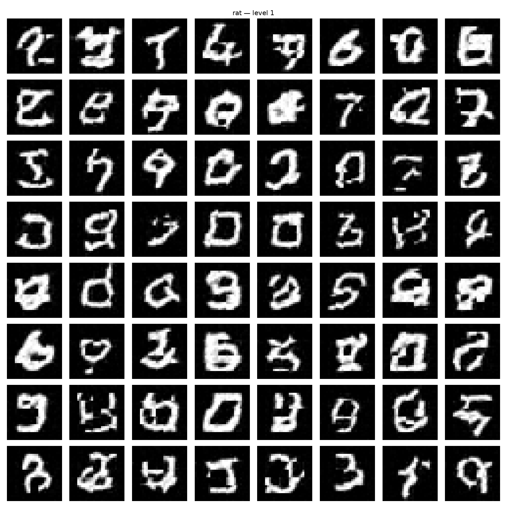
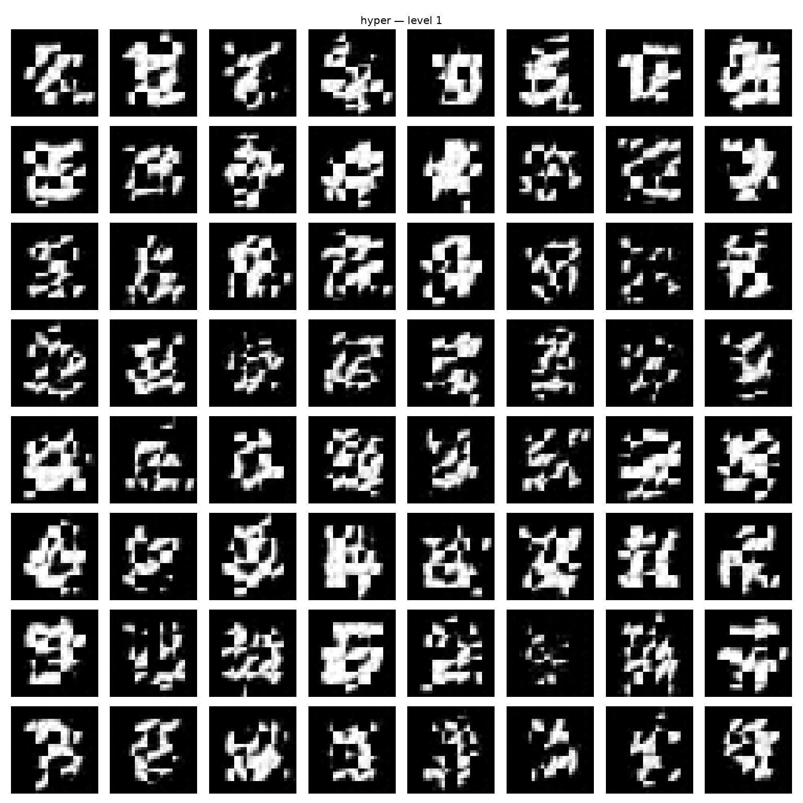

# M1 finding — hyper vs RAT at 49 tokens (MNIST)

**Status:** first CPU result, one seed, no FID. Treat it as a signal, not a
benchmark claim.

## The question and the prior

Question: does a tiny complex-valued diffusion transformer learn images, and is
the hyper (softmax) or RAT (linear fast-weight) attention the better prior at
short image sequences?

The prior was recorded before the run: **hyper expected to win on sample
quality**, because dagoBERT's T=80 A/B had hyper at CRPS 0.2965 vs RAT 0.3099,
with RAT ~1.41× slower. The plan explicitly allowed the prior to lose.

## The result

Matched budget: 28×28 MNIST, 4×4 patches (49 tokens), `n_embd=64`, 4 layers,
batch 64, 3,000 steps, 200 diffusion steps, x0 prediction, DDIM 50, CPU (t14).

| model | heads | params | val x0-MSE | wall time | samples |
|---|---:|---:|---:|---:|---|
| hyper softmax | 4 | 239,617 | 0.0801 | 11.6 min | blob-like, digits not reliable |
| **RAT bidirectional** | **16** | **241,665** | **0.0629** | **18.8 min** | **readable digits** |
| RAT bidirectional | 4 | 239,617 | not run to 3k | — | benchmark only |
| hyper wide 96×6 (4k steps) | 4 | 792,577 | 0.0746 | 36.5 min | blobs with emerging digits |

The val x0-MSE is the raw training model; the sample grids use the EMA weights.
The matched comparison is hyper-4 vs RAT-16: RAT has **21% lower val x0-MSE**
and the sample grid is qualitatively different — readable 0–9 shapes instead of
blobs. The wide hyper model has more than 3× the parameters and still has higher
val loss than RAT-16 at 3k steps.

## The operator's many-head note

The operator said RAT models love many heads, for speed and quality on text.
This run supports both halves at this scale:

| RAT setting | `n_embd` | `n_head` | head size | ms/step (CPU, batch 64) |
|---|---:|---:|---:|---:|
| RAT-4 | 64 | 4 | 16 | 1,033 |
| **RAT-16** | **64** | **16** | **4** | **398** |

More heads made the step **2.6× faster** in this workload and produced the best
loss/sample quality. Note the tension with tardits' state-size law: at fixed
`n_embd`, more heads means a *smaller* fast-weight state (`n_embd * head_size`;
256 for h16 vs 1,024 for h4). So this is not a "more memory" win. At 49 tokens it
is most likely an optimization/rotor effect: many small heads give the decay
more independent phases to fit, and the elementwise cost per head is cheaper.
That is a hypothesis for the next run, not a proven mechanism.

## Why this does not overrule the dagoBERT finding

- The dagoBERT A/B was at **T=80 with a different objective** (v-prediction,
  latent space, BTC). WINK is at **49 tokens, x0 prediction, pixel space**.
- RAT's O(1) decode advantage is irrelevant at 49 tokens. The win here is
  sample quality at a tiny budget, not a long-context claim.
- A single seed and a 3,000-step CPU budget are not a benchmark. The honest
  next step is a second seed, a longer RAT-16 run, and CIFAR-10 FID (M2).
- The prior was not silently moved after the fact. It was recorded in issue #8
  and this note says it lost.

## Caveats

- `val x0-MSE` is comparable only between runs with the same objective. The
  1,000-step epsilon runs report epsilon-MSE and are not in this table.
- Sample quality was judged by eye on 16- and 64-image grids, not by FID.
- MNIST is a smoke test; it cannot support an architecture claim beyond "this
  trains and the operator can read the digits".
- The RAT-16 model uses a smaller state than RAT-4; a capacity sweep at fixed
  head size is still missing.

## Artifacts

| run | MLflow run id | checkpoint |
|---|---|---|
| hyper-4 x0 T=200 | `e65cce8425c74c8c8abf4c7bac3426a3` | `examples/saved/mnist_hyper_x0_t200/final.pt` |
| hyper wide 96×6 x0 T=200 | `8b3410d09fe84a09bc45f4aedf0e4508` | `examples/saved/mnist_hyper_x0_wide/final.pt` |
| RAT-16 x0 T=200 | `0493e9b66f6045cca4aecc2a88c053d8` | `examples/saved/mnist_rat_h16/final.pt` |

Grids: `docs/assets/mnist/rat_h16_final_64.png`,
`docs/assets/mnist/hyper_x0_3k_64.png`, `docs/assets/mnist/hyper_wide_final_64.png`.

## Verdict

At 49 image tokens on CPU, **RAT-16 is the better first prior**. Hyper remains
the reference architecture for longer sequences and for the CIFAR comparison;
the next RAT run should be longer (6k–10k) and at least one more seed before any
strong claim.
